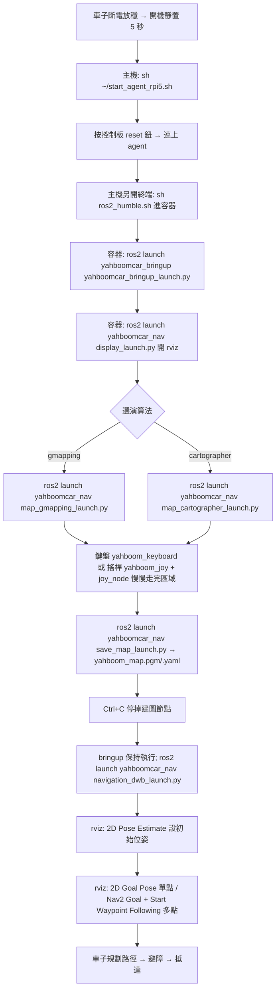

# C1 筆記：光達（MS200）課程——避障、跟隨、警衛、巡邏、建圖、導航

> 資料來源：`research/pdf-text/09.Lidar course/` 全部 9 個檔案＋`official/09.Lidar course/Precautions for Radar Mapping and Navigation.txt`。
> 凡是文件有寫的指令都逐字抄錄；文件沒寫、我自己補的內容會標「【補充／推測】」，教材編寫時請在實車驗證。
> 命名備註：文件裡的「radar／雷達」就是光達（LiDAR，本車為 MS200）。

---

## 1. 概覽

### 1.1 這 9 課在教什麼

| 課 | 名稱 | 一句話 | 難度建議 |
| --- | --- | --- | --- |
| 1 | Lidar avoid | 光達避障：前方有東西就轉彎 | 初級 |
| 2 | Lidar following | 光達跟隨：跟著最近的物體走，保持固定距離 | 初級 |
| 3 | Lidar guard | 光達警衛：原地轉向盯住最近物體，太近就叫 | 初級 |
| 4 | Lidar patrol | 光達巡邏：走正方形／圓／三角形／直線，遇障停下並響蜂鳴器 | 中級 |
| 5 | Gmapping mapping | 用 gmapping（粒子濾波 SLAM）建 2D 地圖 | 中級 |
| 6 | Cartographer mapping | 用 Cartographer（圖最佳化 SLAM）建 2D 地圖 | 中級 |
| 7 | Navigation2 navigation avoid | 載入地圖、設初始位置、點目標，車自己規劃路徑並避障 | 高級 |
| 8 | ROS Robot APP mapping | 用手機 App「ROS Robot」遙控建圖 | 中級 |
| 9 | ROS Robot APP navigation | 用手機 App 設初始點、導航點 | 中級 |

### 1.2 全部課程共同的前置動作（每課開頭都重複）

1. **車子要先「放穩＋靜置 5 秒」讓陀螺儀（IMU）初始化**（`Precautions for Radar Mapping and Navigation.txt`）。原文意思：建圖導航前，先把車斷電並穩穩放在地面，再開機並保持不動 5 秒。沒做的話，會出現「車身沒動，但 rviz 裡的 3D 模型原地旋轉或往某方向漂移」。
2. **`ROS_DOMAIN_ID` 必須與 microROS 控制板一致**（不一致時 `ros2 node list` 看不到車子的節點）。細節在〈MicroROS Control Board Parameter Configuration〉與〈Connect MicroROS Agent〉，不在我負責的範圍。
3. **啟動 agent**（樹莓派 Pi 5 的主機終端，不在 Docker 裡）：

   ```
   sh ~/start_agent_rpi5.sh
   ```

   然後**按一下 microROS 控制板上的 reset 鈕**，等車子連上 agent（文件用截圖展示成功畫面）。
4. **進入車上的 Docker 容器**（另開一個終端，主機上執行）：

   ```
   sh ros2_humble.sh
   ```

   （〈13.Docker course / 5. Enter the robot's docker container〉寫成 `./ros2_humble.sh`，兩者效果相同；腳本放在家目錄 `~`，所以要在家目錄執行。）
   成功進入後，用下面指令確認連線：

   ```
   ros2 node list
   ```

5. **之後所有 `ros2 ...` 指令都在容器內執行**；`sh ~/start_agent_rpi5.sh` 與 `docker ps -a` 這類 docker 指令在主機執行。

### 1.3 學習順序建議（給教材編排）

```
課1 避障 → 課2 跟隨 → 課3 警衛   （只用 /scan 與 /cmd_vel，最容易看懂「感測器→決策→馬達」）
        → 課4 巡邏                （第一次接觸 TF：odom→base_footprint）
        → 課5 gmapping／課6 cartographer（SLAM 概念、地圖檔）
        → 課7 Nav2                （定位 AMCL＋規劃＋costmap＋行為樹）
        → 課8／9 手機 App          （rosbridge 概念，實用）
```

---

## 2. 每一課詳解

### 2.1 第 1 課 Lidar avoid（光達避障）

**在做什麼**：車子訂閱光達資料 `/scan`。前方沒有障礙就前進；偵測到障礙就依左／中／右哪邊有東西決定左轉或右轉。

**ROS 觀念（白話）**

- **`/scan`（`sensor_msgs/LaserScan`）**：光達每轉一圈送出一包「一圈的距離陣列」。重要欄位：`ranges[]`（每條雷射打到東西的距離，單位 m）、`angle_min`（第一條的角度，弧度）、`angle_increment`（相鄰兩條角度差）。要知道第 i 條雷射朝哪個方向：`角度 = angle_min + angle_increment × i`。
- **`/cmd_vel`（`geometry_msgs/Twist`）**：速度命令。`linear.x` 是往前的速度（m/s），`angular.z` 是左轉為正的轉速（rad/s）。
- **`/JoyState`（`std_msgs/Bool`）**：搖桿是否正在操作；搖桿接管時程式自動讓出控制權。
- 這一課是「**訂閱者（subscriber）＋發布者（publisher）**」最好的入門：訂 `/scan`，發 `/cmd_vel`。

**指令（容器內，agent 已連線）**

```
ros2 run yahboomcar_laser laser_Avoidance
```

動態調參（另開一個容器終端；多開終端的方法見 C2 筆記的 Docker 段）：

```
ros2 run rqt_reconfigure rqt_reconfigure
```

首次開啟可能看不到節點，按 **Refresh**；節點名 `laser_Avoidance`。改完數值後要**點一下空白處**才會把參數傳進程式。

**參數**

| 參數 | 意義 |
| --- | --- |
| `linera`（原文拼寫如此，應為 linear） | 線速度 |
| `angular` | 角速度大小 |
| `LaserAngle` | 光達偵測角度（只看正負這個角度內） |
| `ResponseDist` | 障礙偵測距離；物體在此範圍內才算障礙 |
| `Switch` | 功能開關（要打開才會動） |

**程式邏輯（原始碼 `/root/yahboomcar_ws/src/yahboomcar_laser/yahboomcar_laser`，檔名 `laser_Avoidance`）**

- 訂閱 `/scan`（`LaserScan`）、`/JoyState`（`Bool`），發布 `/cmd_vel`（`Twist`）。
- 把角度換成度數並壓到 -180～180；分三區計數：
  - 左：`20 < angle < LaserAngle`
  - 右：`-LaserAngle < angle < -20`
  - 前：`abs(angle) <= 20`
  - 該區內 `ranges[i] < ResponseDist*1.5` 就把該區 warning 計數 +1。
- 判斷用「計數 > 10」代表那一區有障礙（避免單點雜訊）。文件列出的前兩種情形：前＋左＋右皆 > 10 → 右轉（`angular.z = -angular`，同時 `linear.x = linear`）；前方與右側有、左側沒有 → 左轉（`angular.z = +angular`）。其餘分支文件以 `.....` 省略。
- 每次發完速度 `sleep(0.2)`。

**預期結果**：沒障礙往前走，遇到障礙依方位轉向並印出提示（例如 `1, there are obstacles in the left and right, turn right`）。

**注意**：初學者第一次請把車墊高或放在空曠處，先把 `linear` 設小；搖桿一動就會接管。

---

### 2.2 第 2 課 Lidar following（光達跟隨）

**在做什麼**：在光達掃描範圍內找「最近的物體」，用 PID 控制維持設定距離（`ResponseDist`），物體移動車就跟著走／轉。

**ROS 觀念**

- 同樣只用 `/scan` → `/cmd_vel`，差別在於用 **PID 控制器**：距離誤差→線速度，角度誤差→角速度。
- PID 白話：誤差越大，出力越大；再加上累積誤差與變化率讓動作更平順。

**指令**

```
ros2 run yahboomcar_laser laser_Tracker
ros2 run rqt_reconfigure rqt_reconfigure
```

（前置：agent、進容器同 1.2；調參節點名 `laser_Tracker`。）

**參數**

| 參數 | 意義 |
| --- | --- |
| `priorityAngle` | 優先偵測角度（正前方這個範圍內有物體就優先追，文件寫設定為 10 度） |
| `LaserAngle` | 光達偵測角度 |
| `ResponseDist` | 追蹤距離（想與物體保持的距離） |
| `Switch` | 功能開關 |

**程式邏輯重點**（`laser_Tracker`）

- 角度在 `priorityAngle` 內且距離 `< ResponseDist + offset` 的點放進「前方清單」；否則在 `LaserAngle` 內且距離 > 0 的點放進一般清單。
- 有前方清單就取其中最近者，否則取一般清單最近者 → 得到 `minDist`、`minDistID`（角度）。
- 與目標距離差小於 0.1 視為到位（`minDist = ResponseDist`）。
- `velocity.linear.x = -lin_pid.pid_compute(ResponseDist, minDist)`（太近就倒退、太遠就前進）；`ang_pid.pid_compute(minDistID/48, 0)` 算角速度，絕對值 < 0.1 則設 0（死區）。

**預期結果**：緩慢移動被追蹤物（例如手或箱子），車會跟隨。

---

### 2.3 第 3 課 Lidar guard（光達警衛）

**在做什麼**：找最近物體並「原地旋轉」對準它；若該物體比 `ResponseDist` 更近，**蜂鳴器響**（發布 `/beep`）。

**ROS 觀念**：多一個發布者 `/beep`（`std_msgs/UInt16`）：`data = 1` 響、`0` 不響。這是用 ROS 話題控制 ESP32 上周邊的最簡單例子（micro-ROS 控制板訂閱 `/beep`）。

**指令**

```
ros2 run yahboomcar_laser laser_Warning
ros2 run rqt_reconfigure rqt_reconfigure
```

節點名 `laser_Warning`（原始檔名文件寫 `laser_Warnning.py`，拼寫不一致，以實機為準）。

**參數**：`LaserAngle`（偵測角度）、`ResponseDist`（警戒距離，原文寫 tracking distance）、`Switch`。

**預期結果**：沒東西在範圍內印 `no obstacles@`；有東西則印 `---------------` 並響蜂鳴器。程式只發 `angular.z`（沒有線速度），所以是原地轉。

---

### 2.4 第 4 課 Lidar patrol（光達巡邏）

**在做什麼**：車走「直線／圓／正方形／三角形」路線；光達同時監看，遇障礙就停車並響蜂鳴器，障礙移除後繼續。

**ROS 觀念**

- **TF（座標變換）**：機器人身上與環境中有多個座標系（frame），TF 記錄它們的相對位置。這一課用 `odom → base_footprint`：`odom` 是「開機時的起點」，`base_footprint` 是車身在地面上的投影。查這兩者的變換，就能知道「車子從起點走了多遠、轉了多少度」。
- **里程計 odom**：由輪子編碼器＋IMU 估算位置；會有累積誤差（所以課中有 `LineScaling`、`RotationScaling` 校正係數）。
- 巡邏路線＝「直走」與「旋轉」兩個基本動作的組合（`advancing`、`Spin`）。

**指令（順序重要）**

1. 先啟動底層資料處理（會發布 `odom->base_footprint` 的 TF）：

   ```
   ros2 launch yahboomcar_bringup yahboomcar_bringup_launch.py
   ```

2. 啟動巡邏程式：

   ```
   ros2 run yahboomcar_bringup patrol
   ```

3. 開動態參數介面：

   ```
   ros2 run rqt_reconfigure rqt_reconfigure
   ```

4. 在 rqt 找節點 **`YahboomCarPatrol`**；`Command` 選路線，然後把 **`Switch`** 打開才會開始。

**參數**

| 參數 | 意義 |
| --- | --- |
| `odom_frame` | 里程計座標系名稱 |
| `base_frame` | 底盤座標系名稱 |
| `circle_adjust` | 圓形路線時調整圓大小的係數 |
| `Switch` | 功能開關 |
| `Command` | 路線：`LengthTest`（直線）、`Circle`（圓）、`Square`（正方形）、`Triangle`（三角形） |
| `Set_loop` | 循環巡邏（跑完再重來） |
| `ResponseDist` | 障礙偵測距離 |
| `LaserAngle` | 光達偵測角度 |
| `Linear` / `Angular` | 線速度／角速度 |
| `Length` | 直線距離（程式註解：正方形先直走 1 公尺） |
| `RotationTolerance` | 旋轉誤差容許值 |
| `RotationScaling` | 旋轉縮放係數 |

**程式重點（`/root/yahboomcar_ws/src/yahboomcar_bringup/yahboomcar_bringup`，檔名 `patrol.py`）**

- 訂閱 `/scan`、`/JoyState`；發布 `cmd_vel`、`/beep`。
- 用 `tf_buffer.lookup_transform(odom_frame, base_frame, now)` 讀取目前 XY 與 yaw（四元數→RPY）。
- `advancing(target_distance)`：量起點到現在的距離（乘 `LineScaling`），誤差小於 `LineTolerance` 就停；中途 `Joy_active` 或 `warning > 10` 就停車＋響蜂鳴器並印 `obstacles`。
- `Spin(angle)`：累加旋轉角度直到誤差 < `RotationTolerance`。
- `Square()` 用 `self.index` 狀態機：index 0 直走 → 1 旋轉 90° → …；每完成一步把 `Switch` 重新設為 True 以進下一步。

**預期結果**：正方形：直走→轉 90°→重複；遇障停下並 `print("obstacles")`。

**注意**：要先跑 bringup，否則 TF 不存在，程式會一直印 `transform not ready`。

---

### 2.5 第 5 課 Gmapping mapping（gmapping 建圖）

**在做什麼**：邊遙控車子慢慢走，邊用光達建出 2D 佔據柵格地圖（occupancy grid），最後存成 `.pgm` ＋ `.yaml`。

**SLAM 白話**：SLAM＝同時定位與建圖。車子不知道自己在哪、也沒有地圖，就一邊看光達、一邊估自己走了多遠、一邊把看到的牆畫上去。

- **gmapping**：基於 **Rao-Blackwellized 粒子濾波（RBpf）**。每個「粒子」是一個「我可能在這裡、地圖長這樣」的猜測，許多粒子一起猜、挑最像的。改進：改良提議分佈＋選擇性重採樣。
- 優點：室內小場景即時、運算量小、精度高。缺點：場景越大需要越多粒子→記憶體與運算暴增；**沒有迴環偵測（loop closure）**，繞一圈回到原點時地圖可能錯位。
- **重要限制（文件原文）**：gmapping 只適用於「單幀 2D 雷射點數少於 1440」；超過會出現 `[mapping-4] process has died`。

**指令（全部在容器內，各開一個終端）**

```
ros2 launch yahboomcar_bringup yahboomcar_bringup_launch.py
ros2 launch yahboomcar_nav display_launch.py
ros2 launch yahboomcar_nav map_gmapping_launch.py
```

控制車子（鍵盤或搖桿二選一）：

```
#keyboard
ros2 run yahboomcar_ctrl yahboom_keyboard
#handle
ros2 run yahboomcar_ctrl yahboom_joy
ros2 run joy joy_node
```

建完後存圖：

```
ros2 launch yahboomcar_nav save_map_launch.py
```

- 地圖存在 `/root/yahboomcar_ws/src/yahboomcar_nav/maps`，檔名 `yahboom_map.pgm` 與 `yahboom_map.yaml`。
- 順序：bringup（底層資料）→ display（rviz，此時沒資料）→ 建圖節點 → 遙控 → 存圖。

查看用：

```
ros2 run rqt_graph rqt_graph
ros2 run tf2_tools view_frames
```

`rqt_graph` 若一開始沒畫面，選 `[Nodes/Topics(all)]` 再按左上角 refresh。`view_frames` 會在目前目錄生成 `.gv` 與 `.pdf`（TF 樹）。

**地圖 yaml 欄位**

```
image: yahboom_map.pgm
mode: trinary
resolution: 0.05
origin: [-10, -10, 0]
negate: 0
occupied_thresh: 0.65
free_thresh: 0.25
```

| 欄位 | 意義 |
| --- | --- |
| `image` | 地圖圖片檔 |
| `mode` | `trinary`（預設）／`scale`／`raw` |
| `resolution` | 每像素幾公尺（0.05 = 5 公分） |
| `origin` | 地圖左下角的 2D 位姿 (x, y, yaw)，多數地方忽略 yaw |
| `negate` | 是否反轉黑白（閾值解讀不受影響） |
| `occupied_thresh` | 佔據機率大於此值視為完全佔據 |
| `free_thresh` | 小於此值視為完全空閒 |

**Launch 結構**

- `map_gmapping_launch.py`（`/root/yahboomcar_ws/src/yahboomcar_nav/launch`）：include 套件 `slam_gmapping` 的 `slam_gmapping.launch.py`，並啟動一個靜態 TF：

  ```
  package='tf2_ros', executable='static_transform_publisher', name='base_link_to_base_laser',
  arguments=['-0.0046412', '0', '0.094079', '0','0','0', 'base_link', 'laser_frame']
  ```

  意思：光達（`laser_frame`）相對底盤 `base_link` 的位置：x = -0.0046412 m、y = 0、z = 0.094079 m，無旋轉。這是**告訴 ROS「光達裝在車的哪裡」**，沒有它地圖會歪。
- `slam_gmapping.launch.py`（`/root/gmapping_ws/src/slam_gmapping/launch`；注意是 `gmapping_ws` 不是 `yahboomcar_ws`，表示 gmapping 是從原始碼自行編譯的）：啟動節點 `slam_gmapping`（package `slam_gmapping`），載入 `params/slam_gmapping.yaml`。
- 重要參數（`slam_gmapping.yaml`）：`base_frame: base_footprint`、`map_frame: map`、`odom_frame: odom`、`delta: 0.05`（地圖解析度）、`particles: 30`（粒子數）、`maxRange: 6.0`、`maxUrange: 4.0`（光達有效使用距離）、`linearUpdate: 1.0`、`angularUpdate: 0.5`（移動多少才更新）、`map_update_interval: 5.0`、`xmin/ymin: -10.0`、`xmax/ymax: 10.0`（地圖範圍 20 m × 20 m，與 yaml 的 origin -10 對應）、`temporalUpdate: 1.0`、`use_sim_time: false`。

**建圖技巧（文件原話為 slowly walk）**：慢慢走，走完要涵蓋整個區域再存圖。【補充】轉彎要慢，否則掃描比對容易失敗。

---

### 2.6 第 6 課 Cartographer mapping（Cartographer 建圖）

**在做什麼**：與第 5 課相同流程，換 SLAM 演算法。

**Cartographer 白話**：Google 開源的 2D／3D SLAM。把一小段時間的光達資料拼成一張「**子圖 submap**」，很多子圖組成全域地圖。短時間累積誤差小，長時間會累積，所以用**迴環偵測**（scan matching）回頭修正子圖位置（圖最佳化，後端用 Ceres Solver）。可融合光達、IMU、輪式里程計等。`cartographer_ros` 把它接到 ROS 訊息。

**與 gmapping 的差異（教學重點）**

| | gmapping | Cartographer |
| --- | --- | --- |
| 核心 | 粒子濾波 | 圖最佳化＋子圖 |
| 迴環偵測 | 無 | 有 |
| 大場景 | 不適合 | 較適合 |
| 光達點數限制 | < 1440 | 文件未提限制 |
| 設定檔 | `slam_gmapping.yaml` | `lds_2d.lua` |

**指令**（與第 5 課完全相同，只有建圖節點不同）

```
ros2 launch yahboomcar_bringup yahboomcar_bringup_launch.py
ros2 launch yahboomcar_nav display_launch.py
ros2 launch yahboomcar_nav map_cartographer_launch.py
```

遙控與存圖同第 5 課（`yahboom_keyboard` 或 `yahboom_joy`＋`joy_node`；`ros2 launch yahboomcar_nav save_map_launch.py`；同樣存成 `yahboom_map`）。**注意：兩種演算法存出的檔名相同，後存的會覆蓋先存的。**

**Launch 結構**

- `map_cartographer_launch.py`：include `yahboomcar_nav` 的 `cartographer_launch.py` ＋ 同樣的靜態 TF `base_link_to_base_laser`。
- `cartographer_launch.py`：啟動 `cartographer_ros` 的 `cartographer_node`（參數 `-configuration_directory <yahboomcar_nav/params>`、`-configuration_basename lds_2d.lua`，`remappings=[('/odom','/odom')]`），再 include `occupancy_grid_launch.py`（把子圖轉成 `/map` 佔據柵格；參數 `resolution` 預設 `0.05`、`publish_period_sec` 預設 `1.0`）。
- `lds_2d.lua` 重點：`map_frame = "map"`、`tracking_frame = "base_footprint"`、`published_frame = "odom"`、`odom_frame = "odom"`、`provide_odom_frame = false`、`use_odometry = true`、`num_laser_scans = 1`；`TRAJECTORY_BUILDER_2D.use_imu_data = false`、`min_range = 0.10`、`max_range = 3.5`、`use_online_correlative_scan_matching = true`；`POSE_GRAPH.constraint_builder.min_score = 0.65`。（本車的 Cartographer 用輪式里程計、**沒用 IMU**。）

---

### 2.7 第 7 課 Navigation2 navigation avoid（Nav2 導航避障）

**Nav2 白話**：ROS 2 的標準導航框架，目標是把機器人從 A 點安全送到 B 點。由多個「伺服器」組成，用**行為樹（Behavior Tree）**調度：

| 元件 | 做什麼 |
| --- | --- |
| Map Server | 載入／提供／儲存地圖 |
| AMCL | 在已知地圖上用粒子濾波定位（輸出 `map→odom` TF）。AMCL 要你先給「初始位姿」 |
| Planner Server（全域規劃，本車 `NavfnPlanner`） | 在全域 costmap 上規劃 A→B 的路徑 |
| Controller Server（本車 `DWB`） | 沿路徑即時算速度命令，邊走邊避開動態障礙 |
| Costmap 2D | 把感測器資料變成「代價地圖」：障礙物與其周圍膨脹區代價高。分 **global costmap**（整張地圖）與 **local costmap**（車子周圍滾動視窗） |
| BT Navigator + Behavior Trees | 用行為樹組合「規劃→跟隨→失敗時恢復」 |
| Behavior Server（舊稱 Recoveries） | 恢復行為：旋轉、後退、等待… |
| Waypoint Follower | 多點巡航 |
| Lifecycle Manager | 管理各節點生命週期 |

官方資訊（文件列出）：Navigation2 文件 <https://navigation.ros.org/index.html；GitHub> <https://github.com/ros-planning/navigation2；論文> <https://arxiv.org/pdf/2003.00368.pdf；外掛> <https://navigation.ros.org/plugins/index.html#plugins> 。

**指令（容器內，各一個終端）**

```
ros2 launch yahboomcar_bringup yahboomcar_bringup_launch.py
ros2 launch yahboomcar_nav display_launch.py
ros2 launch yahboomcar_nav navigation_dwb_launch.py
```

- 第 2 步開 rviz，此時還沒地圖；第 3 步啟動導航後才會載入地圖。
- 預設載入 `yahboomcar_nav/maps/yahboom_map.yaml`。換地圖可帶參數 `maps:=<yaml 完整路徑>`（寫法見 2.9）。

**操作流程（rviz）**

1. 點 **2D Pose Estimate**，在地圖上對應車子實際位置按住並拖曳方向（給 AMCL 初始位姿）。判斷準不準：光達掃到的點要大致與地圖牆壁重合。
2. 單點導航：點 **2D Goal Pose**，在地圖上點目標，車自動規劃、行走、避障，到點停止。
3. 多點導航：在 rviz 加入 Nav2 面板（plugin），點 **Waypoint / Nav Through Poses Mode**；用工具列 **Nav2 Goal** 點多個目標，再按 **Start Waypoint Following**。車會依序到每點，到最後一點停下等下一個指令。

查看用：

```
ros2 run rqt_graph rqt_graph
ros2 run tf2_tools view_frames
```

**Launch：`navigation_dwb_launch.py`**（`/root/yahboomcar_ws/src/yahboomcar_nav/launch`）

- 參數：`use_sim_time`（預設 false）、`maps`（預設 `<yahboomcar_nav>/maps/yahboom_map.yaml`）、`params_file`（預設 `<yahboomcar_nav>/params/dwb_nav_params.yaml`）。
- include `nav2_bringup` 的 `/launch/bringup_launch.py`（路徑 `/opt/ros/humble/share/nav2_bringup/launch`），傳入 `map`、`use_sim_time`、`params_file`。
- 靜態 TF `base_link_to_base_laser`（同上數值）。
- 節點 `stop_car`（package `yahboomcar_nav`）：Ctrl+C 結束導航時對車發布停車速度，避免車子繼續衝。

**`dwb_nav_params.yaml` 重點（`/root/yahboomcar_ws/src/yahboomcar_nav/params`）**

- `amcl`：`base_frame_id: "base_footprint"`、`global_frame_id: "map"`、`odom_frame_id: "odom"`、`scan_topic: scan`、`min_particles: 500`、`max_particles: 2000`、`laser_model_type: "likelihood_field"`、`robot_model_type: "nav2_amcl::DifferentialMotionModel"`（差速）、`update_min_d: 0.25`、`update_min_a: 0.2`、`transform_tolerance: 1.0`。
- `bt_navigator`：`global_frame: map`、`robot_base_frame: base_link`、`odom_topic: /odom`、`default_bt_xml_filename: "navigate_to_pose_w_replanning_and_recovery.xml"`，並列出一大串 `nav2_*_bt_node` 外掛。
- `controller_server`：`controller_frequency: 20.0`；`general_goal_checker`：`xy_goal_tolerance: 0.25`、`yaw_goal_tolerance: 0.25`；控制器 `FollowPath` = `dwb_core::DWBLocalPlanner`：`max_vel_x: 0.30`、`min_vel_x: -0.20`、`max_vel_theta: 1.0`、`max_vel_y: 0.0`（**不能側移**，因為是差速車）、`acc_lim_x: 2.5`、`acc_lim_theta: 3.2`、`sim_time: 1.7`、`critics: ["RotateToGoal", "Oscillation", "BaseObstacle", "GoalAlign", "PathAlign", "PathDist", "GoalDist"]`（critic 是「評分員」，DWB 對多條候選軌跡打分取最佳）。
- `local_costmap`：`global_frame: odom`、`rolling_window: true`、`width: 3`、`height: 3`（3 m × 3 m 視窗）、`resolution: 0.05`、`robot_radius: 0.22`、插件 `["voxel_layer", "inflation_layer"]`；膨脹 `inflation_radius: 0.55`、`cost_scaling_factor: 3.0`；障礙來源 `/scan`（`obstacle_max_range: 2.5`、`raytrace_max_range: 3.0`）。
- `global_costmap`：`global_frame: map`、`robot_radius: 0.22`、`track_unknown_space: true`、插件 `["static_layer", "obstacle_layer", "inflation_layer"]`。
- `planner_server`：`GridBased` = `nav2_navfn_planner/NavfnPlanner`，`tolerance: 0.5`、`use_astar: false`、`allow_unknown: true`。
- `behavior_server`：`spin`、`backup`、`drive_on_heading`、`assisted_teleop`、`wait`；`max_rotational_vel: 1.0`、`min_rotational_vel: 0.4`。
- `waypoint_follower`：`stop_on_failure: false`，`wait_at_waypoint` 外掛，`waypoint_pause_duration: 200`（毫秒）。
- `velocity_smoother`：`max_velocity: [0.26, 0.0, 1.0]`、`min_velocity: [-0.26, 0.0, -1.0]`、`feedback: "OPEN_LOOP"`。（文件排版上它縮排在 `waypoint_follower` 底下，應為排版之誤，實際檔案請以車上為準。）

**TF 與座標框架（初學者常混淆）**

- 標準鏈：`map → odom → base_footprint (→ base_link) → laser_frame`。
  - `map→odom`：由 AMCL（導航）或 SLAM 節點（建圖）發布。
  - `odom→base_footprint`：由 bringup 的底層程式（里程計）發布。
  - `base_link→laser_frame`：launch 裡的靜態 TF。
- 文件中的 frame 不一致：AMCL／gmapping／cartographer 用 `base_footprint`，而 Nav2 的 `bt_navigator`、costmap 用 `base_link`。這需要 `base_footprint→base_link` 的 TF 存在（應由 bringup 的 URDF／robot_state_publisher 提供；【補充／推測】本課未明說，請在車上用 `view_frames` 驗證）。

**預期結果**：設好初始位姿後，點目標，車走過去；中途放障礙物車會繞開，到點停止。

**注意**：初始位姿錯誤是「導航亂跑」的第一原因。

---

### 2.8 第 8 課 ROS Robot APP mapping（手機 App 建圖）

**在做什麼**：手機裝「**ROS Robot**」App，輸入車子 IP，選 **ROS2**，連線後在手機上用虛擬搖桿遙控建圖，並按儲存地圖。

**ROS 觀念**：**rosbridge**——把 ROS 話題轉成 WebSocket，讓手機／網頁不用裝 ROS 也能訂閱／發布。

**指令（同一個容器開多個終端）**

1. 主機終端：`sh ~/start_agent_rpi5.sh` ＋ reset 鈕；另一終端 `sh ros2_humble.sh`。
2. 容器終端 A：

   ```
   ros2 launch yahboomcar_bringup yahboomcar_bringup_launch.py
   ```

3. **再開新終端並進入「同一個」容器**（不能再跑一次 `sh ros2_humble.sh`，否則是新容器）：

   ```
   docker ps -a
   docker exec -it ef0e1b7da319 /bin/bash
   ```

   （`ef0e1b7da319` 只是文件的範例 ID，**每次都不同**，要換成你自己 `docker ps -a` 看到的 CONTAINER ID。）
4. 容器終端 B（二選一建圖）：

   ```
   ros2 launch yahboomcar_nav map_gmapping_app_launch.xml
   ros2 launch yahboomcar_nav map_cartographer_app_launch.xml
   ```

5. 同一容器的新終端開相機畫面：

   ```
   ros2 launch usb_cam camera.launch.py
   ```

6. 手機 App：輸入車子 IP；語言 `zh`＝中文、`en`＝英文；選 **ROS2**；選下方第一個 **Video Topic**；按 **Connect**。連上後用滑動轉盤控制車慢慢走完要建圖的區域，按儲存地圖、輸入地圖名稱、Submit。
7. 地圖存放：`/root/yahboomcar_ws/src/yahboomcar_nav/maps`。

**Launch：`map_gmapping_app_launch.xml`** 啟動的東西

- `rosbridge_server` 的 `rosbridge_websocket_launch.xml`：開啟 rosbridge，之後可經網路連 ROS。
- 節點 `laserscan_to_point_publisher`（package／exec 同名）：把光達點雲轉成 App 可視化用的格式。
- `yahboomcar_nav` 的 `map_gmapping_launch.py`：gmapping 建圖。
- `robot_pose_publisher_ros2` 的 `robot_pose_publisher_launch.py`：發布車子位姿供 App 顯示。
- `yahboom_app_save_map` 的 `yahboom_app_save_map.launch.py`：儲存地圖。

---

### 2.9 第 9 課 ROS Robot APP navigation（手機 App 導航）

**在做什麼**：手機連車，選「導航」，按「Set Initialization Point」設初始位姿，再按「Set Navigation Point」設目標點，車自己規劃走過去。

**指令**

1. 前置同 1.2（agent、進容器）。
2. 底層：

   ```
   ros2 launch yahboomcar_bringup yahboomcar_bringup_launch.py
   ```

3. App 導航（可換地圖）：

   ```
   ros2 launch yahboomcar_nav navigation_dwb_app_launch.xml maps:=/root/yahboomcar_ws/src/yahboomcar_nav/maps/test1219.yaml
   ```

   （文件排版把它折成兩行；實際是同一行。`test1219.yaml` 是作者自己存過的地圖，**換成你自己的檔名**，例如 `yahboom_map.yaml`。）
4. 相機（同一個容器的新終端）：

   ```
   ros2 launch usb_cam camera.launch.py
   ```

5. App 連線步驟同第 8 課，接著進入 Navigation 介面，**先**設初始化點（雷射點與牆大致重合表示準），**再**設導航點。

**Launch：`navigation_dwb_app_launch.xml`**：`rosbridge_websocket_launch.xml`＋`laserscan_to_point_publisher`＋`navigation_dwb_launch.py`（即第 7 課的導航）＋`robot_pose_publisher_launch.py`。（原文第一行寫 `<launch` 缺 `>`，為排版錯字。）

---

## 3. 總表與流程圖

### 3.1 節點總表

| 節點／可執行檔 | 套件 | 作用 | 出現課 |
| --- | --- | --- | --- |
| `laser_Avoidance` | `yahboomcar_laser` | 避障 | 1 |
| `laser_Tracker` | `yahboomcar_laser` | 跟隨（PID） | 2 |
| `laser_Warning` | `yahboomcar_laser` | 警衛（蜂鳴器） | 3 |
| `patrol`（節點名 `YahboomCarPatrol`） | `yahboomcar_bringup` | 巡邏 | 4 |
| `yahboom_keyboard` | `yahboomcar_ctrl` | 鍵盤遙控 | 5,6 |
| `yahboom_joy` ＋ `joy_node` | `yahboomcar_ctrl`／`joy` | 搖桿遙控 | 5,6 |
| `slam_gmapping` | `slam_gmapping` | gmapping 建圖 | 5 |
| `cartographer_node` | `cartographer_ros` | Cartographer 建圖 | 6 |
| occupancy grid 節點（由 `occupancy_grid_launch.py` 啟動） | `yahboomcar_nav` 內 | 子圖轉 `/map` | 6 |
| `static_transform_publisher`（名稱 `base_link_to_base_laser`） | `tf2_ros` | 靜態 TF：光達位置 | 5,6,7 |
| `stop_car` | `yahboomcar_nav` | Ctrl+C 後發停車 | 7 |
| Nav2 全家（map_server、amcl、planner_server、controller_server、bt_navigator、behavior_server、smoother_server、waypoint_follower、velocity_smoother、lifecycle_manager 等） | `nav2_*` | 導航 | 7 |
| `rosbridge_websocket` | `rosbridge_server` | WebSocket 橋 | 8,9 |
| `laserscan_to_point_publisher` | 同名 | 光達轉 App 格式 | 8,9 |
| `robot_pose_publisher` | `robot_pose_publisher_ros2` | 發布位姿給 App | 8,9 |
| `yahboom_app_save_map` | `yahboom_app_save_map` | App 存圖 | 8 |
| `usb_cam` | `usb_cam` | 相機影像 | 8,9 |
| `rqt_reconfigure`／`rqt_graph`／`view_frames` | `rqt_*`／`tf2_tools` | 除錯工具 | 1-7 |

### 3.2 話題總表

| 話題 | 型別 | 方向 | 說明 |
| --- | --- | --- | --- |
| `/scan` | `sensor_msgs/LaserScan` | 光達→所有程式 | 光達掃描 |
| `/cmd_vel`（巡邏程式寫成 `cmd_vel`） | `geometry_msgs/Twist` | 程式→車 | 速度命令 |
| `/JoyState` | `std_msgs/Bool` | 搖桿節點→程式 | 搖桿接管旗標 |
| `/beep` | `std_msgs/UInt16` | 程式→控制板 | 蜂鳴器 |
| `/odom` | 【補充】`nav_msgs/Odometry` | 底層→Nav2／Cartographer | 里程計 |
| `/map` | 【補充】`nav_msgs/OccupancyGrid` | SLAM／map_server→costmap | 地圖 |
| `/tf`、`/tf_static` | 【補充】`tf2_msgs/TFMessage` | 各節點 | 座標變換 |
| `local_costmap/costmap_raw`、`local_costmap/published_footprint` | — | Nav2 內部 | 行為伺服器使用 |

### 3.3 Launch 檔總表

| Launch 檔 | 套件 | 作用 |
| --- | --- | --- |
| `yahboomcar_bringup_launch.py` | `yahboomcar_bringup` | 底層資料處理（含 `odom->base_footprint` TF）。【推測】光達驅動也在這裡啟動，本組文件未明說 |
| `display_launch.py` | `yahboomcar_nav` | 開 rviz |
| `map_gmapping_launch.py` | `yahboomcar_nav` | gmapping＋靜態 TF |
| `map_cartographer_launch.py` | `yahboomcar_nav` | Cartographer＋靜態 TF |
| `cartographer_launch.py`、`occupancy_grid_launch.py` | `yahboomcar_nav` | Cartographer 內部 |
| `save_map_launch.py` | `yahboomcar_nav` | 存圖 |
| `navigation_dwb_launch.py` | `yahboomcar_nav` | Nav2（DWB）＋靜態 TF＋stop_car |
| `map_gmapping_app_launch.xml`、`map_cartographer_app_launch.xml` | `yahboomcar_nav` | App 建圖 |
| `navigation_dwb_app_launch.xml` | `yahboomcar_nav` | App 導航 |
| `slam_gmapping.launch.py` | `slam_gmapping`（`/root/gmapping_ws`） | gmapping 節點 |
| `bringup_launch.py` | `nav2_bringup`（`/opt/ros/humble/share/nav2_bringup/launch`） | Nav2 官方 |
| `rosbridge_websocket_launch.xml` | `rosbridge_server` | rosbridge |
| `robot_pose_publisher_launch.py` | `robot_pose_publisher_ros2` | 位姿 |
| `yahboom_app_save_map.launch.py` | `yahboom_app_save_map` | App 存圖 |
| `camera.launch.py` | `usb_cam` | 相機 |

### 3.4 重要檔案路徑（容器內）

| 內容 | 路徑 |
| --- | --- |
| 工作空間 | `/root/yahboomcar_ws` |
| 避障／跟隨／警衛原始碼 | `/root/yahboomcar_ws/src/yahboomcar_laser/yahboomcar_laser` |
| 巡邏原始碼 | `/root/yahboomcar_ws/src/yahboomcar_bringup/yahboomcar_bringup`（`patrol.py`） |
| 導航 launch | `/root/yahboomcar_ws/src/yahboomcar_nav/launch` |
| 導航參數 | `/root/yahboomcar_ws/src/yahboomcar_nav/params`（`dwb_nav_params.yaml`、`lds_2d.lua`） |
| 地圖 | `/root/yahboomcar_ws/src/yahboomcar_nav/maps`（`yahboom_map.pgm/.yaml`） |
| gmapping 工作空間 | `/root/gmapping_ws/src/slam_gmapping`（launch、params） |

### 3.5 從建圖到導航的完整流程



文字版（每個步驟的執行位置）：

```
[主機]   sh ~/start_agent_rpi5.sh        (按 reset)
[主機]   sh ros2_humble.sh               → 進容器 #1
[容器#1] ros2 launch yahboomcar_bringup yahboomcar_bringup_launch.py
[容器#2] ros2 launch yahboomcar_nav display_launch.py          (需 docker exec 進同一容器)
[容器#3] ros2 launch yahboomcar_nav map_gmapping_launch.py
[容器#4] ros2 run yahboomcar_ctrl yahboom_keyboard
[容器#5] ros2 launch yahboomcar_nav save_map_launch.py
(換導航) Ctrl+C 建圖節點 → ros2 launch yahboomcar_nav navigation_dwb_launch.py
```

**重要提醒**：文件各課都只寫「開另一個終端」，但每次 `sh ros2_humble.sh` 都會開**新容器**；同一時間要多個終端共用同一台容器，必須用 `docker ps -a` ＋ `docker exec -it <ID> /bin/bash`（文件第 8 課才明確寫，其他課沒寫，初學者會卡在這裡）。【補充】文件另一處（Docker 課第 5 篇）指出每次進入容器 ID 都不同。

---

## 4. 能不能在電腦用 Gazebo 先練？（電腦：Ubuntu 24.04 + ROS 2 Jazzy；車：Humble）

> 本節為我根據 ROS 2 生態的知識整理，**文件中沒有**，凡標【未實測】處請教材撰寫前在 Jazzy 環境實測。

### 4.1 版本差異總覽

| 項目 | 車上 Humble（Ubuntu 22.04，Docker） | 電腦 Jazzy（Ubuntu 24.04） | 影響 |
| --- | --- | --- | --- |
| 模擬器 | Gazebo Classic 通用 | **Gazebo Harmonic（`gz sim`）**；Classic 不支援 Jazzy | 舊教學的 `gazebo_ros` launch 在 Jazzy 無效，要用 `ros_gz_*` |
| gmapping | 車上自行用原始碼編譯到 `/root/gmapping_ws`（`slam_gmapping`，ROS 2 移植版） | **不要預期有可用 apt 套件**【未實測，查證用 `apt-cache search gmapping`】 | 在電腦用 **`slam_toolbox`** 練「SLAM 概念」；gmapping 需要時自行用原始碼編譯 |
| Cartographer | 車上已有 `cartographer_ros` | `ros-jazzy-cartographer-ros` 預期有 apt 套件【未實測】 | 可練，`.lua` 概念相同 |
| Nav2 | `nav2_bringup` Humble | `nav2_bringup` Jazzy | 概念與指令相同，但**參數檔需要改**（見 4.2） |
| 光達話題 | `/scan` | Gazebo 範例通常也是 `/scan` | 課 1-3 的邏輯幾乎可直接搬 |
| 速度命令 | `Twist` | Jazzy 的 Nav2 仍用 `Twist`【未實測】 | Gazebo bridge 要設對型別 |
| ROS 網路 | 容器內 `--net=host` | 同 domain id 可互通（兩版預設都是 Fast DDS，標準訊息相容） | 電腦的 rviz2 可看車子資料，但**自訂訊息／服務可能不相容** |

### 4.2 `dwb_nav_params.yaml` 搬到 Jazzy 要注意（【未實測】）

- 外掛命名格式：Humble 寫 `nav2_navfn_planner/NavfnPlanner`、`nav2_behaviors/Spin`，新版改為 `::` 命名（如 `nav2_navfn_planner::NavfnPlanner`）。
- `bt_navigator` 的 `plugin_lib_names` 清單與 `default_bt_xml_filename` 的做法在新版有變。
- 建議做法：從 Jazzy 的 `nav2_bringup` 範例參數開始，只把數值（速度上限 0.30、`robot_radius: 0.22`、膨脹 0.55、DWB critics）抄過去，不要整份複製。

### 4.3 建議的電腦練習方案

| 想練的 | 建議 |
| --- | --- |
| 課 1-3（避障／跟隨／警衛） | **可以練**：用 Gazebo 的差速車＋光達（例如 TurtleBot3 Gazebo 世界），自己寫 Python 節點：`/scan` → `/cmd_vel`。`yahboomcar_laser` 套件在電腦上沒有，可自己寫或從車上複製原始碼（含自帶的 PID 類別）。蜂鳴器 `/beep` 無對應，可印出代替。 |
| 課 4（巡邏） | 可練：Gazebo 的 `odom`→`base_footprint` TF 與車上同名（取決於模型），原理一致。 |
| 課 5-6（建圖） | 概念可練：`slam_toolbox` 或 Cartographer（TurtleBot3 世界）；**gmapping 不要依賴**。 |
| 課 7（Nav2） | 可練：官方 `nav2_bringup` 的 TurtleBot3 模擬能體驗 AMCL＋costmap＋2D Goal Pose。 |
| 課 8-9（手機 App） | 光達部分不需模擬；建議直接上實車。 |

### 4.4 重要提醒

電腦上的練習，**不能保證與車上完全相同**（版本、套件名稱、參數格式都有差異）。教材應明講：「電腦模擬用來理解概念；真正的指令與參數以車上 Humble 容器為準」。

---

## 5. 教材編寫的注意事項與疑點清單

1. **MS200 的雷射點數、掃描角度、`/scan` frame**：本組文件未寫。gmapping 有 1440 點上限，需確認 MS200 單圈點數（若超過會 `[mapping-4] process has died`）。課中 `minDistID/48` 的 48 是經驗常數，意義待釐清。
2. **光達驅動由誰啟動**：本組文件所有流程都沒有單獨啟動光達的指令，推測在 `yahboomcar_bringup_launch.py` 內；請到〈05.Robot control〉或 source-code 確認。
3. **frame 命名不一致**（`base_link` vs `base_footprint`），見 2.7。
4. App 課程用 `.xml` launch 檔，Nav2 用 `.py`，兩者 `ros2 launch` 用法相同。
5. 文件拼寫錯誤列表（避免教材複製）：`linera`（linear）、`laser_Warnning.py`、`Video Tpoic`、`<launch` 缺 `>`、`rivz`（rviz）。
6. 避障程式在文件裡只列兩個分支（其餘 `.....`）；完整行為要看車上原始碼。
7. 「5 秒陀螺儀初始化」是**最容易被跳過、但會讓建圖／導航整體失敗**的步驟，教材要放在每個流程最前面並加粗。
8. 手機 App「ROS Robot」：文件未給下載連結；IP 用車子的 Wi-Fi IP（熱點模式為 `10.42.0.1`，見 C2 筆記）。
