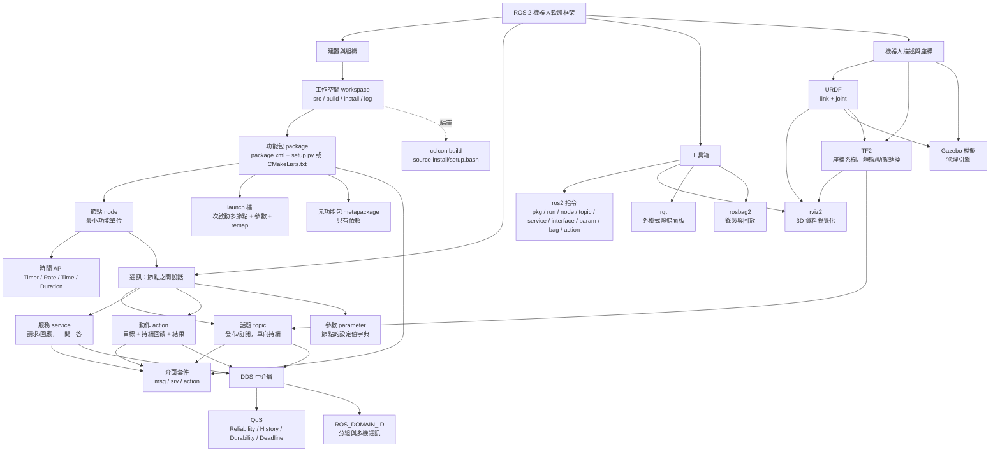

# D：Yahboom 官方「14. ROS2 basic course」研究筆記

> 來源：`research/pdf-text/14. ROS2 basic course/` 共 23 個檔案（PDF 轉文字）。
> 官方環境：ROS 2 Humble + Ubuntu 22.04 + Python 3。使用者 WSL：Ubuntu 24.04 + ROS 2 Jazzy。
> 寫法約定：指令、套件名、檔名、程式碼保留原文；觀念白話說明用繁體中文。

## 0. 閱讀本筆記前先知道的三件事（PDF 轉文字的限制與官方文件的瑕疵）

1. **圖片內容全部遺失**：PDF 內的截圖（setup.py 的 `entry_points` 修改、URDF 的 XML 範例、`package.xml` 截圖、執行結果畫面）在文字檔裡都沒有。凡是「預期結果」只在截圖裡的地方，本筆記標示「（截圖，推算）」並用程式邏輯推算。
2. **程式碼版面被轉亂**：第 6、11、23 課的 Python 程式，行內註解跑到別行、縮排錯位。本筆記「還原」成可執行的縮排版本，並以「（還原）」標示；程式邏輯、變數名、字串與原文一致。
3. **官方文件有筆誤**（教材撰寫時要避開，詳見各課「官方瑕疵」與第 4 節）：`sudo apt Update`、`ros-humle-desktop`、`ros2 service list` 的 Format 寫成 `ros2 interface show`、`ros2 interface call`（應為 `ros2 service call`）、第 10 課 srv 段落寫「same as Person.msg」等。

---

## 1. 概覽：23 課的學習順序與脈絡

官方課程可分成七個階段，由「裝好環境」一路走到「座標轉換與模擬」：

| 階段 | 課號 | 主題 | 一句話 |
| --- | --- | --- | --- |
| A 認識與安裝 | 1, 2, 3 | ROS2 簡介、安裝 Humble、開發環境 | 知道 ROS2 是什麼、裝起來、準備好終端機/VSCode/Git |
| B 工程骨架 | 4, 5, 6 | 工作空間、功能包、節點 | `colcon build` 的世界：workspace → package → node |
| C 三種通訊 | 7, 8, 9 | 話題、服務、動作 | 節點之間說話的三種方式 |
| D 介面與參數 | 10, 11, 12 | 自訂介面、參數、元功能包 | 自己定義訊息格式、設定值共享、套件打包 |
| E 網路與底層 | 13, 14, 15 | 分散式通訊、DDS/QoS、時間 API | 多台電腦怎麼連、底層 DDS 與 QoS、Rate/Timer/Time/Duration |
| F 工具箱 | 16, 17, 18, 20 | 常用指令、rviz2、rqt、bag | 除錯與視覺化工具 |
| G 系統整合 | 19, 21, 22, 23 | Launch、URDF、Gazebo、TF2 | 一次啟動多節點、描述機器人、模擬、座標系 |

依賴關係（建議順序）：1→2→3→4→5→6→7→8→9→10→11→12→13→14→15→16→17→18→19→20→21→22→23。實務上第 16（指令）和 18（rqt）可以提前，第 19（launch）在學完 7 之後就能讀。第 23（TF2）最難，需要第 7、8、11、15、19 全部先會。

Yahboom 相關線索：第 4 課工作空間叫 `yahboomcar_ws`；第 10 課出現 `~/yahboomcar_ros2_ws/yahboomcar_ws`；第 11 課預設參數值是 `'muto'`；第 21 課要複製 `yahboomcar_description` 套件（教材資料夾內，PDF 沒有）；第 13 課的車子跑在 Docker 的 host 網路模式。

---

## 2. 逐課筆記

### 第 1 課　Introduction to ROS2（ROS2 簡介）

**觀念白話**

- ROS2 是第二代機器人作業系統（Robot Operating System），其實不是「作業系統」，而是跑在 Linux 等系統上的**機器人軟體框架 + 一堆工具**。第一版 Arden 在 2017 發表（官方文字如此寫，一般慣稱 Ardent）。
- ROS 版本跟 Ubuntu 版本綁定，要下載對應版本。官方以 Humble 當範例，說「課程程式適用所有 ROS2 版本」。

**ROS2 的特色（官方列點）**

- 全支援三平台：Ubuntu、Mac OS X、Windows 10。
- **分散式架構、取消 master 節點**：節點自動互相發現（discovery），支援 publish/subscribe 與 request/response。
- 即時性（real-time）支援。
- 程式語言：C++11、Python 3.5+。
- 新建置系統 **Ament**（ROS1 是 Catkin）；ROS1 可經 rosbridge 與 ROS2 通訊。

**ROS1 與 ROS2 差異**

| 項目 | ROS1 | ROS2 |
| --- | --- | --- |
| 平台 | 主要 Linux/Ubuntu | Ubuntu、Windows，甚至嵌入式板 |
| 語言 | C++03、Python 2 | C++11、Python 3.5+（Foxy 用 Python 3.8） |
| 中介層 | 要先啟動 `roscore`（master 統管通訊） | 無 master，抽象中介層介面，目前全部以 **DDS** 實作，提供多種 QoS |
| 編譯 | `catkin_make` | `colcon build` |

**預期結果**：純概念課，無指令。

---

### 第 2 課　ROS2 install Humble（安裝 Humble）

**觀念**：Humble 只支援 Ubuntu 22.04。要裝別的版本，把指令中的 `humble` 換成該版本代號。

**完整步驟（逐字）**

1. 設定 locale（需支援 UTF-8）：

```bash
locale   # 檢查是否支援 UTF-8
sudo apt update && sudo apt install locales
sudo locale-gen en_US en_US.UTF-8
sudo update-locale LC_ALL=en_US.UTF-8 LANG=en_US.UTF-8
export LANG=en_US.UTF-8
locale   # 驗證
```
1. 設定軟體源：

```bash
sudo apt install software-properties-common
sudo add-apt-repository universe
sudo apt update && sudo apt install curl gnupg lsb-release -y
sudo curl -sSL https://raw.githubusercontent.com/ros/rosdistro/master/ros.key -o /usr/share/keyrings/ros-archive-keyring.gpg
echo "deb [arch=$(dpkg --print-architecture) signed-by=/usr/share/keyrings/ros-archive-keyring.gpg] http://packages.ros.org/ros2/ubuntu $(source /etc/os-release && echo $UBUNTU_CODENAME) main" | sudo tee /etc/apt/sources.list.d/ros2.list > /dev/null
```
1. 安裝：

```bash
sudo apt update          # 官方原文寫成 "sudo apt Update"（大寫 U，筆誤，會失敗）
sudo apt upgrade
sudo apt install ros-humble-desktop python3-argcomplete
sudo apt install python3-colcon-common-extensions
```
1. 設定環境（每開一個新終端都要 source，或寫進 `~/.bashrc`）：

```bash
source /opt/ros/humble/setup.bash
echo "source /opt/ros/humble/setup.bash" >> ~/.bashrc
```
1. 驗證：

```bash
ros2 run demo_nodes_cpp talker      # 發布者
ros2 run demo_nodes_cpp listener    # 訂閱者（另開終端）
```
1. 小烏龜：

```bash
ros2 run turtlesim turtlesim_node
ros2 run turtlesim turtle_teleop_key
ros2 topic echo /turtle1/cmd_vel
```
1. 解除安裝：

```bash
sudo apt remove ~nros-humble-* && sudo apt autoremove
sudo rm /etc/apt/sources.list.d/ros2.list
sudo apt update
sudo apt autoremove
```

**預期結果**：talker 每秒印 `Publishing: 'Hello World: N'`，listener 印 `I heard: [Hello World: N]`（官方文字無列出輸出，此為 demo_nodes_cpp 的標準行為）；小烏龜視窗彈出，方向鍵可移動烏龜，`topic echo` 會印 Twist 訊息。

**官方瑕疵**：`sudo apt Update`；`ros-humle-desktop`（第 12 課）。

---

### 第 3 課　ROS2 development environment（開發環境）

**內容**

- 編輯器：VSCode（裝常用外掛）。
- 終端機：**Terminator**（`sudo apt install terminator`，快捷鍵 `Ctrl+Alt+T` 啟動）。ROS 要同時開很多終端，分割視窗很方便。
- 常用 Terminator 快捷鍵（官方完整表，節錄最常用）：`Ctrl+Shift+O` 水平分割、`Ctrl+Shift+E` 垂直分割、`Alt+方向鍵` 切換分割窗、`Ctrl+Shift+W` 關閉當前、`Ctrl+Shift+T` 新分頁、`Ctrl+Shift+X` 最大化、`Super+g` 全部終端同步輸入（Super+Shift+G 解除）、`Ctrl+Shift+C/V` 複製貼上、`Ctrl+Shift+F` 搜尋。
- **Git**：`sudo apt install git`。工作區 → 暫存區 → 本地倉庫 → 遠端倉庫。
  - 最簡流程：`git init`、`git add .`、`git commit`。
  - 官方指令表：`git clone`、`git push`、`git add`、`git commit`、`git checkout`、`git pull`、`git status`、`git diff`、`git reset`、`git rm`、`git mv`、`git switch`、`git restore`、`git log`、`git blame <file>`、`git remote`、`git fetch`。
  - 查說明：`git --help`。

**預期結果**：純環境準備。

---

### 第 4 課　ROS2 Workspace（工作空間）

**觀念白話**：工作空間（workspace）就是一個放程式碼、參數、腳本的資料夾，是 ROS 開發的「專案資料夾」。可以有很多個（`ros2_ws_a`、`ros2_ws_b` 並存）。

**指令（逐字）**

```bash
mkdir -p yahboomcar_ws/src
cd ~/yahboomcar_ws
colcon build
source install/setup.bash                                      # 只對目前終端有效
echo "source ~/yahboomcar_ws/install/setup.bash" >> ~/.bashrc   # 所有終端有效
```

（註：官方 `mkdir -p yahboomcar_ws/src` 是相對路徑，要先在家目錄；後面 `cd ~/yahboomcar_ws` 才接得起來。）

**四個子目錄**

- `src`：程式碼空間，你只要在這裡動手。
- `build`：編譯中間檔。
- `install`：編譯完成的可執行檔與腳本，**執行時用的是這裡**。
- `log`：編譯與執行日誌。

**預期結果**：`colcon build` 後出現 `build`、`install`、`log` 三個新目錄（原文有截圖）。

---

### 第 5 課　ROS2 Function Packages（功能包）

**觀念白話**：功能包（package）是把不同功能（運動控制、視覺、導航…）的程式分開打包，降低耦合、方便分享重用。

**建立功能包指令**

```bash
ros2 pkg create <package_name> --build-type <build-type> --dependencies <dependencies> --node-name <node-name>
```

- `--build-type`：C/C++ 用 `ament_cmake`，Python 用 `ament_python`。
- `--dependencies`：C++ 必含 `rclcpp`，Python 必含 `rclpy`。
- `--node-name`：可選，自動產生可執行檔的原始碼與設定。

官方範例：

```bash
cd workspace/src
ros2 pkg create pkg_helloworld_cpp --build-type ament_cmake --dependencies rclcpp --node-name helloworld
ros2 pkg create pkg_helloworld_py --build-type ament_python --dependencies rclpy --node-name helloworld
```

**編譯**

```bash
colcon build                                   # 全部
colcon build --packages-select pkg1 pkg2        # 指定
```

**套件結構**

- C++ 包：`package.xml`（套件名、版本、作者、依賴）、`CMakeLists.txt`（編譯規則）、`src/`、`include/`、`msg/`、`srv/`、`action/`。
- Python 包：`package.xml`、`setup.py`（類似 CMakeLists.txt）、`setup.cfg`、`resource/`、`test/`、與套件同名的資料夾（放 .py 原始碼）。
- 兩者都可自訂：`launch/`、`rviz/`、`urdf/`、`params/`、`world/`、`map/` 等。

---

### 第 6 課　ROS2 Node（節點）

**觀念白話**：節點（Node）是 ROS 裡的最小功能單位，一個節點負責一件事（例如雷達驅動節點、相機驅動節點）。一個可執行檔可以有一個或多個節點。

**建立節點流程**：建程式檔 → 匯入 ROS 函式庫 → 寫節點函式 → 寫設定檔（setup.py）→ 編譯執行。

**步驟**

```bash
cd workspace/src
ros2 pkg create pkg_helloworld_py --build-type ament_python --dependencies rclpy --node-name helloworld
```

（官方原文寫成 `` `ment_python` `` 且帶反引號，是排版錯誤。）

刪掉自動產生的 `helloworld.py`，寫入（還原）：

```python
import rclpy                          # ROS2 Python 介面庫
from rclpy.node import Node           # ROS2 節點類
import time

"""
建立一個 HelloWorld 節點，初始化時輸出 "Hello World"
"""

class HelloWorldNode(Node):
    def __init__(self, name):
        super().__init__(name)                   # ROS2 節點父類初始化
        while rclpy.ok():                        # 檢查 ROS2 是否正常運行
            self.get_logger().info("Hello World")  # 輸出日誌
            time.sleep(0.5)                      # 休眠控制循環時間

def main(args=None):
    rclpy.init(args=args)                        # 初始化 ROS2 Python 介面
    node = HelloWorldNode("helloworld")          # 建立並初始化節點物件
    rclpy.spin(node)                             # 循環等待 ROS2 退出
    node.destroy_node()                          # 銷毀節點物件
    rclpy.shutdown()                             # 關閉 ROS2 Python 介面
```

> 教材觀察：`while rclpy.ok()` 寫在 `__init__` 裡，程式永遠卡在建構式，**`rclpy.spin(node)` 實際上不會被執行到**。這個範例只是為了看到印字，不是良好寫法；正確做法是用 `create_timer`（見第 7 課）。教學時要提醒。

setup.py 的 `entry_points`（官方此處是截圖，文字沒有）：`ros2 pkg create --node-name helloworld` 會**自動**產生 `'helloworld = pkg_helloworld_py.helloworld:main'`，所以覆寫同名檔案時不用再改。

**編譯與執行**

```bash
colcon build --packages-select pkg_helloworld_py
source install/setup.bash
ros2 run pkg_helloworld_py helloworld
```

**預期結果**：終端每 0.5 秒印一行 `[INFO] [時間] [helloworld]: Hello World`。

---

### 第 7 課　ROS2 Topic Communication（話題通訊）

**觀念白話**：話題（topic）是 ROS2 最常用的通訊，**發布/訂閱**模型。發布者往一個有名字的 topic 丟資料，所有訂閱這個名字的訂閱者都收得到；每個 topic 有名字與固定資料型別。像廣播電台，不管有沒有人收聽。

**建立套件**

```bash
ros2 pkg create pkg_topic --build-type ament_python --dependencies rclpy --node-name publisher_demo
```

**publisher_demo.py（逐字，縮排還原）**

```python
#Import the rclpy library
import rclpy
from rclpy.node import Node
#Import String messages
from std_msgs.msg import String
#Create a Topic_Pub node subclass that inherits from the Node base
class Topic_Pub(Node):

    def __init__(self,name):
        super().__init__(name)
        #topic data type, topic name, queue length
        self.pub = self.create_publisher(String,"/topic_demo",1)
        #Create a timer that enters the interrupt handler every 1 second
        self.timer = self.create_timer(1,self.pub_msg)

    def pub_msg(self):
        msg = String()
        msg.data = "Hi,I send a message."
        self.pub.publish(msg)

def main():
    rclpy.init()
    pub_demo = Topic_Pub("publisher_node")
    rclpy.spin(pub_demo)
    pub_demo.destroy_node()
    rclpy.shutdown()
```

**subscriber_demo.py（逐字）**

```python
import rclpy
from rclpy.node import Node
from std_msgs.msg import String

class Topic_Sub(Node):
    def __init__(self,name):
        super().__init__(name)
        #topic data type, topic name, callback function name, queue length.
        self.sub = self.create_subscription(String,"/topic_demo",self.sub_callback,1)

    def sub_callback(self,msg):
        self.get_logger().info(msg.data)

def main():
    rclpy.init()
    sub_demo = Topic_Sub("subscriber_node")
    rclpy.spin(sub_demo)
    sub_demo.destroy_node()
    rclpy.shutdown()
```

**setup.py（官方是截圖，文字缺）**：`subscriber_demo.py` 是手動新增的，所以要在 `console_scripts` 加入（依 8、9 課格式推得）：

```python
'subscriber_demo = pkg_topic.subscriber_demo:main',
```

（`publisher_demo` 因 `--node-name` 自動已有。）

**編譯與執行**

```bash
colcon build --packages-select pkg_topic
source install/setup.bash
ros2 run pkg_topic publisher_demo
ros2 topic list
ros2 topic echo /topic_demo
ros2 run pkg_topic subscriber_demo
```

**預期結果**：publisher 執行時終端沒輸出；`ros2 topic list` 看到 `/topic_demo`；`ros2 topic echo /topic_demo` 印出 `data: Hi,I send a message.`；subscriber 終端每秒印 `Hi,I send a message.`。

---

### 第 8 課　ROS2 Service Communication（服務通訊）

**觀念白話**：服務（service）是**請求/回應**（client/server，CS 模型）。像你瀏覽網頁：瀏覽器是 client 送請求，網站伺服器回傳頁面。與話題不同，是一問一答、有需要才呼叫。

**建立套件**

```bash
ros2 pkg create pkg_service --build-type ament_python --dependencies rclpy --node-name server_demo
```

**server_demo.py（逐字）**

```python
import rclpy
from rclpy.node import Node
from example_interfaces.srv import AddTwoInts

class Service_Server(Node):
    def __init__(self,name):
        super().__init__(name)
        #Service data type, service name, service callback function
        self.srv = self.create_service(AddTwoInts, '/add_two_ints', self.Add2Ints_callback)

    def Add2Ints_callback(self,request,response):
        response.sum = request.a + request.b
        print("response.sum = ",response.sum)
        return response

def main():
    rclpy.init()
    server_demo = Service_Server("publisher_node")
    rclpy.spin(server_demo)
    server_demo.destroy_node()
    rclpy.shutdown()
```

（官方節點名誤寫成 `"publisher_node"`，其實是 server；可改 `"server_node"`。）

查看介面：

```bash
ros2 interface show example_interfaces/srv/AddTwoInts
```

輸出：`int64 a` / `int64 b` / `---` / `int64 sum`。`---` 上面是 request，下面是 response。

**setup.py 的 console_scripts 加入**

```python
'server_demo = pkg_service.server_demo:main',
'client_demo = pkg_service.client_demo:main'
```

**用指令呼叫**

```bash
colcon build --packages-select pkg_service
ros2 run pkg_service server_demo
ros2 service list
ros2 service call /add_two_ints example_interfaces/srv/AddTwoInts "{a: 1, b: 4}"
```

預期：回傳 `sum=5`，server 終端印 `response.sum =  5`。

**client_demo.py（逐字）**

```python
import rclpy
from rclpy.node import Node
from example_interfaces.srv import AddTwoInts

class Service_Client(Node):
    def __init__(self,name):
        super().__init__(name)
        self.client = self.create_client(AddTwoInts,'/add_two_ints')
        while not self.client.wait_for_service(timeout_sec=1.0):
            print("service not available, waiting again...")
        self.request = AddTwoInts.Request()

    def send_request(self):
        self.request.a = 10
        self.request.b = 90
        self.future = self.client.call_async(self.request)

def main():
    rclpy.init()
    service_client = Service_Client("client_node")
    service_client.send_request()
    while rclpy.ok():
        rclpy.spin_once(service_client)
        if service_client.future.done():
            try:
                response = service_client.future.result()
                print("service_client.request.a = ",service_client.request.a)
                print("service_client.request.b = ",service_client.request.b)
                print("Result = ",response.sum)
            except Exception as e:
                service_client.get_logger().info('Service call failed %r' % (e,))
            break
    service_client.destroy_node()
    rclpy.shutdown()
```

**執行**：先 `ros2 run pkg_service server_demo`，再 `ros2 run pkg_service client_demo`。
**預期**：client 印 `request.a = 10`、`request.b = 90`、`Result = 100`；server 也印 `response.sum = 100`。

**觀念重點**：client 用 `call_async` 非同步呼叫，用 `future.done()` 判斷結果；必須先確認 server 在線（`wait_for_service`）。

---

### 第 9 課　ROS2 Action Communication（動作通訊）

**觀念白話**：動作（action）= 有**持續回饋**的請求/回應。適合「要花一段時間才能完成的任務」（走到某點、轉到某角度）。client 送出目標（goal），server 執行過程中不斷回報進度（feedback），最後給結果（result）。還能取消。

**範例**：client 傳整數 N，server 把 1 加到 N，每加一次回報進度，最後回傳總和。

**步驟 1：介面套件（ament_cmake）**

```bash
ros2 pkg create --build-type ament_cmake pkg_interfaces
```

在 `pkg_interfaces/action/Progress.action`：

```
int64 num
---
int64 sum
---
float64 progress
```

（三段式：目標 / 結果 / 回饋。）

`package.xml` 加入：

```xml
<buildtool_depend>rosidl_default_generators</buildtool_depend>
<exec_depend>rosidl_default_runtime</exec_depend>
<depend>action_msgs</depend>
<member_of_group>rosidl_interface_packages</member_of_group>
```

`CMakeLists.txt` 加入：

```cmake
find_package(rosidl_default_generators REQUIRED)
rosidl_generate_interfaces(${PROJECT_NAME}
   "action/Progress.action"
)
```

編譯並驗證：

```bash
colcon build --packages-select pkg_interfaces
source install/setup.bash
ros2 interface show pkg_interfaces/action/Progress
```

**步驟 2：動作套件**

```bash
ros2 pkg create pkg_action --build-type ament_python --dependencies rclpy pkg_interfaces --node-name action_server_demo
```

**action_server_demo.py（逐字，含簡體中文日誌字串）**

```python
import time
import rclpy
from rclpy.action import ActionServer
from rclpy.node import Node

from pkg_interfaces.action import Progress

class Action_Server(Node):

    def __init__(self):
        super().__init__('progress_action_server')
        self._action_server = ActionServer(
            self,
            Progress,
            'get_sum',
            self.execute_callback)
        self.get_logger().info('动作服务已经启动！')

    def execute_callback(self, goal_handle):
        self.get_logger().info('开始执行任务....')
        feedback_msg = Progress.Feedback()
        sum = 0
        for i in range(1, goal_handle.request.num + 1):
            sum += i
            feedback_msg.progress = i / goal_handle.request.num
            self.get_logger().info('连续反馈: %.2f' % feedback_msg.progress)
            goal_handle.publish_feedback(feedback_msg)
            time.sleep(1)

        goal_handle.succeed()
        result = Progress.Result()
        result.sum = sum
        self.get_logger().info('任务完成！')
        return result

def main(args=None):
    rclpy.init(args=args)
    Progress_action_server = Action_Server()
    rclpy.spin(Progress_action_server)
    Progress_action_server.destroy_node()
    rclpy.shutdown()
```

setup.py：`'action_server_demo = pkg_action.action_server_demo:main',`

指令測試：

```bash
colcon build --packages-select pkg_action
ros2 run pkg_action action_server_demo
ros2 action list                     # 看到 /get_sum
ros2 action send_goal /get_sum pkg_interfaces/action/Progress "{num: 10}"
```

**預期**：server 每秒印進度 `0.10, 0.20 … 1.00`；client 最後得到 `sum = 55`。（官方指令未加 `--feedback`，要看見回饋可加。）

**action_client_demo.py（逐字）**

```python
import rclpy
from rclpy.action import ActionClient
from rclpy.node import Node
from pkg_interfaces.action import Progress

class Action_Client(Node):

    def __init__(self):
        super().__init__('progress_action_client')
        self._action_client = ActionClient(self, Progress, 'get_sum')

    def send_goal(self, num):
        goal_msg = Progress.Goal()
        goal_msg.num = num
        self._action_client.wait_for_server()
        self._send_goal_future = self._action_client.send_goal_async(goal_msg, feedback_callback=self.feedback_callback)
        self._send_goal_future.add_done_callback(self.goal_response_callback)

    def goal_response_callback(self, future):
        goal_handle = future.result()
        if not goal_handle.accepted:
            self.get_logger().info('请求被拒绝')
            return
        self.get_logger().info('请求被接收，开始执行任务！')
        self._get_result_future = goal_handle.get_result_async()
        self._get_result_future.add_done_callback(self.get_result_callback)

    def get_result_callback(self, future):
        result = future.result().result
        self.get_logger().info('最终计算结果:sum = %d' % result.sum)
        rclpy.shutdown()

    def feedback_callback(self, feedback_msg):
        feedback = (int)(feedback_msg.feedback.progress * 100)
        self.get_logger().info('当前进度: %d%%' % feedback)

def main(args=None):
    rclpy.init(args=args)
    action_client = Action_Client()
    action_client.send_goal(10)
    rclpy.spin(action_client)
```

setup.py：`'action_client_demo = pkg_action.action_client_demo:main'`

**執行**：先 `ros2 run pkg_action action_server_demo`，再 `ros2 run pkg_action action_client_demo`。預期 client 依序印「请求被接收」「当前进度: 10%…100%」「最终计算结果:sum = 55」。

**觀念重點**：action 的非同步鏈 = `send_goal_async` → goal_response_callback（被接受？）→ `get_result_async` → get_result_callback。

---

### 第 10 課　ROS2 Custom Interface Messages（自訂介面）

**觀念白話**：topic、service、action 都靠「介面」定義資料長什麼樣子。介面副檔名：`.msg`（話題）、`.srv`（服務）、`.action`（動作）。自訂介面要放在一個獨立的 `ament_cmake` 介面套件（沿用第 9 課的 `pkg_interfaces`）。

**流程**：建介面套件 → 寫 .msg/.srv/.action → 改設定檔 → 編譯 → 測試。

**Person.msg**（放 `pkg_interfaces/msg/`）

```
string name
int32 age
float64 height
```

**Add.srv**（放 `pkg_interfaces/srv/`）

```
int32 num1
int32 num2
---
int32 sum
```

`CMakeLists.txt` 最終版：

```cmake
rosidl_generate_interfaces(${PROJECT_NAME}
   "action/Progress.action"
   "msg/Person.msg"
   "srv/Add.srv"
)
```

`package.xml` 與第 9 課相同四行（`rosidl_default_generators`、`rosidl_default_runtime`、`action_msgs`、`rosidl_interface_packages`）。

編譯與驗證：

```bash
colcon build --packages-select pkg_interfaces
source install/setup.bash
ros2 interface show pkg_interfaces/msg/Person
ros2 interface show pkg_interfaces/srv/Add
```

（官方 srv 段落路徑是 `cd ~/yahboomcar_ros2_ws/yahboomcar_ws`。）
**預期**：輸出與檔案內容一致。

**官方瑕疵**：本課引用「[11. ROS2 Action Communication Server Implementation]」其實是第 9 課；srv 驗證結尾寫「same as Person.msg」，應為 Add.srv。

---

### 第 11 課　ROS2 Parameter service case（參數）

**觀念白話**：參數（parameter）像「全域設定字典」：名字（key）+值（value），讓多個節點共享設定。一個節點改了參數，其他節點能立即得知。每個參數屬於某個節點。

**用小烏龜體驗**

```bash
ros2 run turtlesim turtlesim_node
ros2 run turtlesim turtle_teleop_key
ros2 param list
ros2 param describe turtlesim background_b      # 看說明
ros2 param get turtlesim background_b           # 查值
ros2 param set turtlesim background_b 10        # 改值（視窗背景色改變）
ros2 param dump turtlesim >> turtlesim.yaml     # 存成 YAML
ros2 param load turtlesim turtlesim.yaml        # 一次載入
```

（官方節點名寫 `turtlesim`；實際完整名稱為 `/turtlesim`，加不加斜線 Humble 都接受。）

**寫程式：param_demo**

```bash
ros2 pkg create pkg_param --build-type ament_python --dependencies rclpy --node-name param_demo
```

param_demo.py（還原）：

```python
import rclpy                          # ROS2 Python 介面庫
from rclpy.node import Node           # ROS2 節點類

class ParameterNode(Node):
    def __init__(self, name):
        super().__init__(name)
        self.timer = self.create_timer(2, self.timer_callback)   # 每 2 秒執行
        self.declare_parameter('robot_name', 'muto')              # 宣告參數，預設 muto

    def timer_callback(self):
        robot_name_param = self.get_parameter('robot_name').get_parameter_value().string_value
        self.get_logger().info('Hello %s!' % robot_name_param)

def main(args=None):
    rclpy.init(args=args)
    node = ParameterNode("param_declare")
    rclpy.spin(node)
    node.destroy_node()
    rclpy.shutdown()
```

```bash
colcon build --packages-select pkg_param
source install/setup.bash
ros2 run pkg_param param_demo
ros2 param set param_declare robot_name Robot       # 另一個終端
```

**預期**：先每 2 秒印 `Hello muto!`，設定後變成 `Hello Robot!`。

**觀念重點**：參數必須先 `declare_parameter` 才能被外部 `set`；節點名稱 `param_declare` 是 `ros2 param set` 的第一個參數（不是套件名）。

---

### 第 12 課　ROS2 meta-function package（元功能包）

**觀念白話**：元功能包（metapackage）是一個「虛擬套件」，自己沒有內容，只**依賴**其他套件，像書的目錄。裝它一個，相關套件全部一起裝。例：`ros-humble-desktop`、`navigation2`。

**做法**

```bash
ros2 pkg create pkg_metapackage
```

`package.xml`（逐字重點）：

```xml
<?xml version="1.0"?>
<?xml-model href="http://download.ros.org/schema/package_format3.xsd" schematypens="http://www.w3.org/2001/XMLSchema"?>
<package format="3">
  <name>pkg_metapackage</name>
  <version>0.0.0</version>
  <description>TODO: Package description</description>
  <maintainer email="1461190907@qq.com">root</maintainer>
  <license>TODO: License declaration</license>

  <buildtool_depend>ament_cmake</buildtool_depend>
  <exec_depend>pkg_interfaces</exec_depend>
  <exec_depend>pkg_helloworld_py</exec_depend>
  <exec_depend>pkg_topic</exec_depend>
  <exec_depend>pkg_service</exec_depend>
  <exec_depend>pkg_action</exec_depend>
  <exec_depend>pkg_param</exec_depend>

  <test_depend>ament_lint_auto</test_depend>
  <test_depend>ament_lint_common</test_depend>

  <export>
    <build_type>ament_cmake</build_type>
  </export>
</package>
```

`CMakeLists.txt`：

```cmake
cmake_minimum_required(VERSION 3.5)
project(pkg_metapackage)

if(CMAKE_COMPILER_IS_GNUCXX OR CMAKE_CXX_COMPILER_ID MATCHES "Clang")
   add_compile_options(-Wall -Wextra -Wpedantic)
endif()

find_package(ament_cmake REQUIRED)

ament_package()
```

`colcon build --packages-select pkg_metapackage`（不會產生可執行檔）。

---

### 第 13 課　ROS2 Distributed Communication（分散式通訊）

**觀念白話**：ROS2 天生分散式，底層 DDS。同一個網路（同 WiFi/路由器）、同一個 **ROS_DOMAIN_ID**（預設 0）的電腦，節點會自動互相發現，不用設定。Domain ID 就像「頻道/分組」，不同 ID 互相看不到。

**測試（兩台電腦 A、B，需裝同版本 ROS2）**

```bash
# A
ros2 run demo_nodes_py talker
# B
ros2 run demo_nodes_py listener
```

B 收到 A 的訊息 = 多機通訊成功。官方說明車子在 Docker，Docker 是 **host 網路模式**（與車子共用網路），指令等同直接在車上跑。Windows 的虛擬機要設「橋接模式」才會與主機在同網段。

**分組**：在雙方 `.bashrc` 加同樣的值：

```bash
echo "export ROS_DOMAIN_ID=6" >> ~/.bashrc     # 6 可換，要符合規則
source ~/.bashrc
ros2 run demo_nodes_py talker                  # 車子
ros2 run demo_nodes_py listener                # 從機（虛擬機）
```

**遠端控制烏龜**：A `ros2 run turtlesim turtlesim_node`；B `ros2 run turtlesim turtle_teleop_key`。

**限制與計算規則（進階）**

- 建議 `ROS_DOMAIN_ID` 在 **[0, 101]**。
- 每個 domain 最多 120 個節點；domain 101 最多 54 個。
- 推導：DDS 起始埠 7400，每個 domain 佔 250 埠 → 理論 [0,231]；Linux 保留埠使實際可用 [0,101] 與 [215,231]；Windows/Mac 為 [0,166]；每個節點 2 埠，(250-10)/2 = 120。

**預期結果**：listener 印出 talker 的 `Hello World: N`；ID 不同則收不到。

---

### 第 14 課　ROS2 DDS

**觀念白話**

- DDS = Data Distribution Service，OMG 於 2004 發表的即時系統「資料分發/訂閱」標準，最早由美國海軍採用。強調**以資料為中心**（data-centric），提供豐富的服務品質（QoS）策略。
- topic、service、action 的底層都是 DDS，可看成 ROS 系統的「神經網路」。
- **四種通訊模型比較**（官方）：
  1. 點對點（Peer-to-Peer）：連線數隨節點增加暴增，client 要知道 server 位址。
  2. 代理（Broker）：由 broker 集中處理，但 broker 是效能瓶頸與單點故障；**ROS1 的 master 類似此架構**。
  3. 廣播（Broadcast）：不用知道位址，但所有節點都要處理所有訊息。
  4. **資料中心 DDS**：像「旋轉火鍋」，資料放在 DataBus 上，每個節點只拿自己要的。
- **Domain**：把應用綁在一起的基本單位，即上一課的 domain ID。
- **QoS 策略**（官方列）：
  - DEADLINE：資料須在期限內傳到。
  - HISTORY：快取多少歷史資料。
  - RELIABILITY：`BEST_EFFORT`（網路差時順暢但可能掉資料）／`RELIABLE`（可靠、重傳）。
  - DURABILITY：把歷史資料送給後加入的節點。

**實驗 1：命令列設定 QoS**

```bash
ros2 topic pub /chatter std_msgs/msg/Int32 "data: 66" --qos-reliability best_effort
ros2 topic echo /chatter --qos-reliability reliable        # QoS 不相容 → 警告、收不到
ros2 topic echo /chatter --qos-reliability best_effort     # 相同 → 收得到
```

**實驗 2：Python 程式**

```bash
ros2 pkg create learning_dds --build-type ament_python --dependencies rclpy std_msgs
```

`dds_controller_pub.py`（逐字，縮排還原）：

```python
import rclpy
from rclpy.node import Node
from std_msgs.msg import String
from rclpy.qos import QoSProfile, QoSReliabilityPolicy, QoSHistoryPolicy

class ControllerPublisher(Node):
    def __init__(self, name):
        super().__init__(name)
        self.qos_profile = QoSProfile(
            reliability=QoSReliabilityPolicy.RELIABLE,
            history=QoSHistoryPolicy.KEEP_LAST,
            depth=1
        )
        self.publisher = self.create_publisher(String, "/robot_cmd", self.qos_profile)
        self.timer = self.create_timer(1.0, self.timer_callback)
        self.cmd_list = ["forward", "backward", "stop"]
        self.cmd_index = 0

    def timer_callback(self):
        current_cmd = self.cmd_list[self.cmd_index % 3]
        msg = String()
        msg.data = current_cmd
        self.publisher.publish(msg)
        self.get_logger().info(f"发布控制指令：{msg.data}")
        self.cmd_index += 1

def main(args=None):
    rclpy.init(args=args)
    node = ControllerPublisher("robot_controller_pub")
    rclpy.spin(node)
    node.destroy_node()
    rclpy.shutdown()

if __name__ == "__main__":
    main()
```

`dds_robot_sub.py`：結構相同，QoS 改 `reliability=QoSReliabilityPolicy.BEST_EFFORT`，`create_subscription(String, "/robot_cmd", self.cmd_callback, self.qos_profile)`，callback 印 `f"接收控制指令：{msg.data} → 执行对应动作"`，節點名 `"robot_subscriber"`。

`setup.py`：

```python
entry_points={
    'console_scripts': [
        'dds_controller_pub = learning_dds.dds_controller_pub:main',
        'dds_robot_sub = learning_dds.dds_robot_sub:main',
    ],
},
```

```bash
colcon build --packages-select learning_dds
source install/setup.bash
ros2 run learning_dds dds_controller_pub
ros2 run learning_dds dds_robot_sub
```

**預期**：publisher 每秒輪播 forward、backward、stop；subscriber 收到並印出。

**QoS 相容規則（補充，官方未寫清）**：RELIABLE 發布者可配 BEST_EFFORT 訂閱者（相容，所以此範例能通）；BEST_EFFORT 發布者配 RELIABLE 訂閱者則**不相容**（實驗 1 的警告）。官方提醒：發布與訂閱最好用相同 QoS。

---

### 第 15 課　ROS2 time related API（時間 API）

建立套件：`ros2 pkg create learning_time --build-type ament_python --dependencies rclpy`

**(1) create_rate：以固定頻率執行迴圈**

- 原理：記錄每圈開始時間 → 執行 → 計算差值 → 自動 sleep 補足，使「圈與圈」間隔固定。
- **不要在主執行緒直接用**（會阻塞 callback），要放子執行緒。
- Rate 與 Timer：Rate = 迴圈內主動睡眠（阻塞該執行緒），可 `break`；Timer = callback 驅動（不阻塞），要靠旗標控制。

`rate_demo.py`（逐字）：

```python
import rclpy
from rclpy.node import Node
import threading

class RateExampleNode(Node):
    def __init__(self):
        super().__init__("rate_example_node")
        self.get_logger().info("Rate 示例节点启动")

    def run_loop(self):
        rate = self.create_rate(2)       # 2Hz
        count = 0
        try:
            while rclpy.ok():
                self.get_logger().info(f"循环执行 {count} 次")
                count += 1
                rate.sleep()
        except KeyboardInterrupt:
            self.get_logger().info("循环被中断")

def main(args=None):
    rclpy.init(args=args)
    node = RateExampleNode()
    loop_thread = threading.Thread(target=node.run_loop)
    loop_thread.start()
    try:
        rclpy.spin(node)
    except KeyboardInterrupt:
        pass
    finally:
        loop_thread.join()
        node.destroy_node()
        rclpy.shutdown()

if __name__ == "__main__":
    main()
```

entry：`'rate_demo=learning_time.rate_demo:main'`；執行 `ros2 run learning_time rate_demo`。預期：每 0.5 秒印「循环执行 N 次」。

**(2) Timer**：`Timer_demo.py`（檔名首字母大寫 T）建立 1 秒與 0.5 秒兩個 timer：

```python
self.counter = 0
self.timer = self.create_timer(1.0, self.timer_callback)
self.fast_timer = self.create_timer(0.5, self.fast_timer_callback)
```

- `timer_callback`：`self.counter += 1`；`current_time = self.get_clock().now()`；印 `f"[1秒定时器] 第 {self.counter} 次执行，当前时间: {current_time.seconds_nanoseconds()}"`。
- `fast_timer_callback`：印 `f"[0.5秒定时器] 当前时间戳: {self.get_clock().now().nanoseconds}"`。
- entry：`'Timer_demo=learning_time.Timer_demo:main'`；執行 `ros2 run learning_time Timer_demo`。

**(3) get_clock**：`get_clock_demo.py`：`self.clock = self.get_clock()`；`current_time = self.clock.now()`；`self.get_logger().info(f"当前时间：{current_time}")`；`main` 用 `rclpy.spin_once(node)` 只跑一次。entry：`'get_clock_demo=learning_time.get_clock_demo:main'`。

**(4) Time 與 Duration**：Time = 某個時間點；Duration = 一段時間。`TimeDuration_demo.py`：

```python
time1 = Time(seconds=10)
time2 = Time(seconds=4)
duration1 = Duration(seconds=3)
duration2 = Duration(seconds=5)
# 比較與運算
time1 >= time2 ; time1 < time2
t3 = time1 + duration1
t4 = time1 - time2
t5 = time1 - duration1
duration1 >= duration2 ; duration1 < duration2
```

`main()` 用 `rclpy.init()` + `rclpy.create_node("time_opt_node")`，以 `node.get_logger().info("t3 = %d" % t3.nanoseconds)` 等印出，最後 `rclpy.shutdown()`。entry：`'TimeDuration_demo=learning_time.TimeDuration_demo:main'`。
**預期（截圖，推算）**：`time1 >= time2 ? 1`、`time1 < time2 ? 0`、`t3 = 13000000000`、`t4 = 6000000000`、`t5 = 7000000000`、`duration1 >= duration2 ? 0`、`duration1 < duration2 ? 1`。

---

### 第 16 課　ROS2 Common Command Tools（常用指令）

| 類別 | 指令 | 用途 |
| --- | --- | --- |
| 套件 | `ros2 pkg create <name> --build-type <type> --dependencies <deps>` | 建立 |
| | `ros2 pkg list` | 列出所有套件 |
| | `ros2 pkg executables pkg_name` | 列出套件內可執行檔 |
| 執行 | `ros2 run pkg_name node_name` | 執行節點 |
| 節點 | `ros2 node list` | 目前 domain 的所有節點 |
| | `ros2 node info node_name` | 節點的訂閱/發布/服務/動作 |
| 話題 | `ros2 topic list` | 列出話題 |
| | `ros2 topic info topic_name` | 型別、發布/訂閱數 |
| | `ros2 topic type topic_name` | 訊息型別 |
| | `ros2 topic hz topic_name` | 平均發布頻率 |
| | `ros2 topic echo topic_name` | 印出訊息（當訂閱者） |
| | `ros2 topic pub topic_name message_type message_content` | 發布；預設 1Hz；`-1` 一次、`-t count` 次數、`-r count` 頻率 |
| 介面 | `ros2 interface list` | 列出所有介面 |
| | `ros2 interface show interface_name` | 顯示定義 |
| 服務 | `ros2 service list` | 列出服務 |
| | `ros2 service call service_name service_type arguments` | 呼叫服務 |

官方範例：

```bash
ros2 topic pub turtle1/cmd_vel geometry_msgs/msg/Twist "{linear: {x: 0.5, y: 0.0, z: 0.0}, angular: {x: 0.0, y: 0.0, z: 0.2}}"
ros2 service call /spawn turtlesim/srv/Spawn "{x: 2, y: 2, theta: 0.2, name: 'turtle10'}"
```

注意：YAML 每個冒號後要有空格，否則格式錯誤。

**官方瑕疵**：6.1 的 `ros2 service list` 格式欄誤寫成 `ros2 interface show interface_name`；6.2 寫成 `ros2 interface call ...`，**正確是 `ros2 service call`**（範例本身是對的）。

---

### 第 17 課　ROS2 rviz2 use（rviz2）

**觀念白話**：rviz2 是機器人**資料視覺化**工具（3D 顯示相機影像、雷達點雲、機器人模型、TF、路徑…）。資料用來算，視覺化給人看。

**沒有實體機器人時：用 TurtleBot3 + Gazebo 模擬**

```bash
sudo apt install ros-${ROS_DISTRO}-turtlebot3*
sudo apt install ros-${ROS_DISTRO}-ros-gz         # 官方這樣寫（見第 4 節，與其 gazebo_ros 指令不一致）
export TURTLEBOT3_MODEL=waffle
ros2 launch turtlebot3_gazebo turtlebot3_world.launch.py
rviz2
```

**加顯示項目**（左側 Displays →「Add」）：

- **Image**：Fixed Frame 選 `base_footprint`（避免座標轉換錯誤）；Topic 選 `/camera/image_raw`。
- **LaserScan**：Topic 選 `/scan`（官方打成 `/sacn`）。
- **RobotModel**：Description Topic 選 `/robot_description`（官方打成 `/robot_deseription`）。
- 其他：`rviz_default_plugins` 還有許多（TF、Map、Path、PointCloud2…）。
- 在 Docker 內啟動要確保 GUI 可用。

---

### 第 18 課　ROS2 rqt toolbox（rqt 工具箱）

- rqt 是另一個模組化（Qt）視覺化工具，桌面版預設已裝。補裝：`sudo apt install ros-${ROS_DISTRO}-rqt*`。
- 啟動：`rqt` 或 `ros2 run rqt_gui rqt_gui`。
- 用「Plugins」選單加外掛：
  - **Topic 外掛**：發送速度指令控制烏龜。
  - **Service 外掛**：呼叫 `/spawn` 在指定位置生成烏龜。
  - **Parameter 外掛**：動態改烏龜視窗背景色。
- 本課另有示範動畫 gif（PDF 外）。
- 常用 rqt 外掛（補充）：`rqt_graph`（看節點與話題連線圖）、`rqt_console`、`rqt_plot`、`rqt_tf_tree`。

---

### 第 19 課　ROS2 Launch startup file configuration（Launch 啟動檔）

**觀念白話**：launch 檔是一個腳本，**一次啟動多個節點並設定參數**。格式有 Python、XML、YAML 三種；Python 最彈性（可用 Python 函式庫、能用所有 launch 功能）。Python launch 的核心概念：把節點、檔案、腳本都抽象成 **action**，用統一介面啟動。

準備：`ros2 pkg create learn_launch --build-type ament_python`，在套件內建 `launch/` 資料夾。命名慣例：`LaunchName_launch.py`（`_launch.py` 固定）。

**setup.py 要改（讓 launch 檔被安裝到 install）**

```python
import os
from glob import glob

# data_files 清單內加入：
(os.path.join('share', package_name, 'launch'), glob(os.path.join('launch', '*launch.py')))
```

**(1) 單一節點 `single_node_launch.py`**

```python
from launch import LaunchDescription
from launch_ros.actions import Node

def generate_launch_description():
    node = Node(
        package='pkg_helloworld_py',
        executable='helloworld',
        output='screen'
    )
    return LaunchDescription([node])
```

```bash
colcon build --packages-select learn_launch
ros2 launch learn_launch single_node_launch.py
```

`package` = 套件名，`executable` = 可執行檔名。

**(2) 多節點 `multi_node_launch.py`**：兩個 `Node`（`pkg_topic` 的 `publisher_demo`、`subscriber_demo`，皆 `output='screen'`），`LaunchDescription([publisher_node, subscriber_node])`。驗證：`ros2 launch learn_launch multi_node_launch.py`，並用 `ros2 node list` 確認。

**(3) 話題重新映射 `remap_name_launch.py`**

```python
publisher_node = Node(
    package='pkg_topic',
    executable='publisher_demo',
    output='screen',
    remappings=[("/topic_demo", "/topic_update")]
)
```

預期：`ros2 topic list` 由 `/topic_demo` 變成 `/topic_update`。

**(4) 巢狀引入 `include_launch.py`**

```python
from launch import LaunchDescription
from launch_ros.actions import Node
import os
from launch.actions import IncludeLaunchDescription
from launch.launch_description_sources import PythonLaunchDescriptionSource
from ament_index_python.packages import get_package_share_directory

def generate_launch_description():
    hello_launch = IncludeLaunchDescription(PythonLaunchDescriptionSource(
        [os.path.join(get_package_share_directory('learn_launch'), 'launch'),
         '/multi_node_launch.py']),
    )
    return LaunchDescription([hello_launch])
```

`ros2 launch learn_launch include_launch.py`。

**(5) 綜合範例 `complex_launch.py`（逐字重點）**：使用

- `DeclareLaunchArgument("background_r", default_value=TextSubstitution(text="0"))`；`background_g` 預設 `"255"`；`background_b` 預設 `"0"`；`chatter_ns` 預設 `"my/chatter/ns"`。
- `launch_include`：引入 `demo_nodes_cpp` 的 `launch/topics/talker_listener.launch.py`。
- `launch_include_with_namespace = GroupAction(actions=[PushRosNamespace(LaunchConfiguration('chatter_ns')), IncludeLaunchDescription(...同上...)])`。
- `turtlesim_node = Node(package='turtlesim', namespace='turtlesim1', executable='turtlesim_node', name='sim')`。
- `turtlesim_node_with_parameters = Node(package='turtlesim', namespace='turtlesim2', executable='turtlesim_node', name='sim', parameters=[{"background_r": LaunchConfiguration('background_r'), "background_g": ..., "background_b": ...}])`。
- `forward_turtlesim_commands_to_second_turtlesim_node = Node(package='turtlesim', executable='mimic', name='mimic', remappings=[('/input/pose', '/turtlesim1/turtle1/pose'), ('/output/cmd_vel', '/turtlesim2/turtle1/cmd_vel')])`。
- 回傳 `LaunchDescription([4 個 DeclareLaunchArgument, launch_include, launch_include_with_namespace, turtlesim_node, turtlesim_node_with_parameters, forward_turtlesim_commands_to_second_turtlesim_node])`。

匯入清單：`os`、`ament_index_python.get_package_share_directory`、`LaunchDescription`、`DeclareLaunchArgument/IncludeLaunchDescription/GroupAction`、`PythonLaunchDescriptionSource`、`LaunchConfiguration/TextSubstitution`、`launch_ros.actions.Node/PushRosNamespace`。

```bash
ros2 launch learn_launch complex_launch.py
ros2 run turtlesim turtle_teleop_key --ros-args -r __ns:=/turtlesim1
```

**預期**：兩隻烏龜，第二隻（背景綠色，因 g=255）完全模仿第一隻（mimic）。可在命令列覆寫參數（官方未示範，標準語法）：`ros2 launch learn_launch complex_launch.py background_r:=255`。

**(6) XML 版 `complex_launch.xml`**：`<arg name="background_r" default="0"/>`…、`<include file="$(find-pkg-share demo_nodes_cpp)/launch/topics/talker_listener.launch.py"/>`、`<group><push-ros-namespace namespace="$(var chatter_ns)"/><include .../></group>`、`<node pkg="turtlesim" exec="turtlesim_node" name="sim" namespace="turtlesim1"/>`、帶 `<param name="background_r" value="$(var background_r)"/>` 的第二個 node、`<node pkg="turtlesim" exec="mimic" name="mimic"><remap from="/input/pose" to="/turtlesim1/turtle1/pose"/><remap from="/output/cmd_vel" to="/turtlesim2/turtle1/cmd_vel"/></node>`。執行 `ros2 launch learn_launch complex_launch.xml`。XML/YAML 檔也要在 setup.py 的 data_files 加入 glob 才會被安裝（官方此處為截圖）。

**(7) YAML 版 `complex_launch.yaml`**：以 `launch:` 為根，`- arg:`（name/default）、`- include: file:`、`- group:`（`- push-ros-namespace: namespace:`、`- include:`）、`- node:`（pkg/exec/name/namespace/param/remap）。執行 `ros2 launch learn_launch complex_launch.yaml`。

**預期結果**：三種格式行為相同：兩隻烏龜，鍵盤控制 turtle1，turtle2 模仿。

---

### 第 20 課　ROS2 recording and playback tool（rosbag2 錄製與回放）

**觀念白話**：`ros2 bag`（官方寫作 Bag2）把 topic 資料錄成檔案，之後不用啟動節點就能重新播放。用途：機器人出問題時錄下來反覆測試、分享給別人驗證演算法。

```bash
ros2 run demo_nodes_py talker                  # 被錄的來源
ros2 bag record /topic-name                     # 錄單一話題
ros2 bag record topic-name1 topic-name2         # 錄多個
ros2 bag record -a                              # 錄全部
ros2 bag record -o file-name topic-name         # -o 自訂輸出名稱
# -s 指定儲存格式；官方說目前只支援 sqlite3（官方拼成 sqllite3）
ros2 bag info rosbag2_2023_10_31-07_58_23       # 看時間、大小、型別、筆數
ros2 bag play rosbag2_2023_10_31-07_58_23
ros2 topic echo /chatter
ros2 bag play rosbag2_2023_10_31-07_58_23 -r 10       # 10 倍速
ros2 bag play rosbag2_2023_10_31-07_58_23 -l          # 循環播放
ros2 bag play rosbag2_2023_10_31-07_58_23 --topics /chatter   # 只播單一話題
```

停止錄製：終端按 `Ctrl+C`，會產生名為 `rosbag2_年_月_日-時_分_秒` 的資料夾。
**預期**：回放後 `ros2 topic echo /chatter` 看到 talker 的歷史訊息。

---

### 第 21 課　ROS2 URDF Model（URDF 機器人模型）

**觀念白話**：URDF（Unified Robot Description Format，統一機器人描述格式）是用 **XML** 描述機器人本體（和外部環境）的格式。機器人可拆成四部分：硬體結構、驅動系統、感測系統、控制系統，建模就是用語言逐一描述再組裝。

> 注意：此課文字檔中的 XML 標籤（`<link>`、`<visual>`、`<joint>`…）被轉換過程吃掉了，只剩敘述；以下 XML 標籤名稱依 URDF 標準補回。

**Link（連桿）**：描述剛體的外觀與物理屬性。

- `<visual>`：外觀（`<geometry>` 形狀，如 STL 網格；`<origin>` 座標偏移 xyz + rpy）。
- `<collision>`：碰撞模型（常簡化成圓柱/方塊，省運算）。
- `<inertial>`：質量與慣性矩陣。
- `name`：之後 joint 連接時使用的名稱。

**Joint（關節）六種**：

1. `continuous`：可無限旋轉（車輪）。
2. `revolute`：有角度限制的旋轉（機械臂）。
3. `prismatic`：滑動，有位置限制（線性馬達）。
4. `fixed`：固定不動（相機固定在車身）。
5. `floating`：浮動。
6. `planar`：平面（後兩者少用）。

Joint 子標籤：`<parent>`、`<child>`、`<origin>`（兩連桿座標系關係）、`<axis>`（運動軸單位向量，z=1 即繞 z 軸）、`<limit>`（最小位置、最大位置、最大速度）。

**整機**：所有 link 與 joint 放在一個 `<robot>` 標籤內。讀 URDF 時，先找 link 和 joint 看整體組成，再看細節。

**實作（Yahboom 教材）**

- 把教材資料夾裡的 **`yahboomcar_description`** 套件複製到工作空間 `src`。套件內含 `urdf`（URDF/XACRO）、`meshes`、`launch`、`rviz`。

```bash
colcon build --packages-select yahboomcar_description
source install/setup.bash
ros2 launch yahboomcar_description display.launch.py
```

**預期**：自動開 rviz2 並顯示機器人模型。（官方以 `muto` 為例；套件不在 PDF 內，本機需另行取得。）

---

### 第 22 課　ROS2 Gazebo Simulation Platform（Gazebo 模擬）

**觀念白話**：Gazebo 是 ROS 最常用的 3D 物理模擬平台（動力學、摩擦、彈性）。先模擬、確認演算法正確，再上真機。官方明講：「本節僅供學習，教程不配置環境，因為我們用真機偵錯」。

**(官方為 Gazebo Classic)**

```bash
sudo apt install ros-${ROS_DISTRO}-gazebo-*
gazebo --verbose -s libgazebo_ros_init.so -s libgazebo_ros_factory.so
```

可選：離線模型放 `~/.gazebo/models`（<https://github.com/osrf/gazebo_models）。>

啟動後：

```bash
ros2 node list          # /gazebo
ros2 service list
```

三個特別的服務：`/spawn_entity`（載入模型）、`/get_model_list`（取模型清單）、`/delete_entity`（刪除模型）。

**建 myrobot 套件**

```bash
ros2 pkg create myrobot --build-type ament_cmake
```

建 `launch/`、`urdf/`，`urdf/demo01_base.urdf`（逐字）：

```xml
<robot name="myrobot">
  <link name="base_link">
    <visual>
      <geometry><box size="0.2 0.2 0.2"/></geometry>
      <origin xyz="0.0 0.0 0.0"/>
    </visual>
    <collision>
      <geometry><box size="0.2 0.2 0.2"/></geometry>
      <origin xyz="0.0 0.0 0.0"/>
    </collision>
    <inertial>
      <mass value="0.1"/>
      <inertia ixx="0.000190416666667" ixy="0" ixz="0" iyy="0.0001904" iyz="0" izz="0.00036"/>
    </inertial>
  </link>
  <gazebo reference="base_link">
    <material>Gazebo/Red</material>
  </gazebo>
</robot>
```

`launch/bringup_model.launch.py`（還原）：

```python
import os
from launch import LaunchDescription
from launch.actions import ExecuteProcess
from launch_ros.actions import Node
from launch_ros.substitutions import FindPackageShare
from launch_ros.parameter_descriptions import ParameterValue
from launch.substitutions import Command

def generate_launch_description():
    robot_name_in_model = 'myrobot'
    package_name = 'myrobot'
    urdf_name = "demo01_base.urdf"

    ld = LaunchDescription()
    pkg_share = FindPackageShare(package=package_name).find(package_name)
    urdf_model_path = os.path.join(pkg_share, f'urdf/{urdf_name}')

    # Start Gazebo server
    start_gazebo_cmd = ExecuteProcess(
        cmd=['gazebo', '--verbose', '-s', 'libgazebo_ros_init.so', '-s', 'libgazebo_ros_factory.so'],
        output='screen')

    # Launch the robot
    spawn_entity_cmd = Node(
        package='gazebo_ros',
        executable='spawn_entity.py',
        arguments=['-entity', robot_name_in_model, '-file', urdf_model_path],
        output='screen')

    ld.add_action(start_gazebo_cmd)
    ld.add_action(spawn_entity_cmd)
    return ld
```

`CMakeLists.txt` 加入（把 urdf、launch 裝進 install）：

```cmake
install(
  DIRECTORY urdf launch
  DESTINATION share/${PROJECT_NAME}
)
```

```bash
colcon build --packages-select myrobot
source install/setup.bash
ros2 launch myrobot bringup_model.launch.py
```

**預期**：Gazebo 裡出現一個紅色方塊（`<gazebo>` 標籤設了 `Gazebo/Red`）。`-entity` = 模型在 Gazebo 裡的名稱，`-file` = 載入的 URDF 路徑。

**⚠ 這一課在 Jazzy 上整個無法照做**（Gazebo Classic 已停止維護，見第 4 節）。

---

### 第 23 課　ROS2 TF2 Coordinate Transformation（TF2 座標轉換）

**觀念白話**：機器人系統有很多座標系（coordinate frame）：`base_link`（車體中心）、`laser_link`（雷達）、`odom`（里程計，會累積漂移）、`map`（絕對位置）。有些固定、有些持續變化。**TF2** 是 ROS 的座標系管理工具，記錄每個座標系之間的「平移 + 旋轉」（背後是 4×4 矩陣），讓你隨時問「A 座標系看 B 座標系在哪裡」。

**3. 命令列體驗（兩隻烏龜追逐）**

```bash
sudo apt install ros-${ROS_DISTRO}-turtle-tf2-py ros-humble-tf2-tools    # 官方第二個寫死 humble
sudo pip3 install transforms3d
sudo apt install ros-${ROS_DISTRO}-rqt-tf-tree

ros2 launch turtle_tf2_py turtle_tf2_demo.launch.py
ros2 run turtlesim turtle_teleop_key            # 控制一隻，另一隻自動跟隨
ros2 run rqt_tf_tree rqt_tf_tree                 # 看 TF 樹
ros2 run tf2_ros tf2_echo turtle2 turtle1        # 持續印兩座標系的轉換值
rviz2                                            # Fixed Frame 設 world，加 TF 顯示
```

**4. 靜態座標轉換**（兩座標系相對位置固定，例如雷達相對 base_link）：

```bash
ros2 run tf2_ros static_transform_publisher 0 0 3 0 0 3.14 A B
ros2 run tf2_ros tf2_echo A B
rviz2        # 加 TF 顯示
```

（舊式位置參數格式為 `x y z yaw pitch roll frame_id child_frame_id`，所以官方的 `3.14` 其實是 **roll**，不是 yaw。）

**5–6. 烏龜跟隨原理**：三座標系 `world`（全域）、`turtle1`、`turtle2`。從 turtle2 看 turtle1 的位置向量：**向量長度 = 距離、方向 = 角度**。用角度決定轉向、用距離決定前進速度，發布到 `turtle2/cmd_vel`。因為兩隻烏龜一直在動，所以要用 TF 的**動態廣播**（broadcaster）與**監聽**（listener）週期性計算。學習目標：寫動態廣播器、寫座標轉換監聽、把距離/角度轉成速度（官方稱 PID，但程式實際只有比例控制 P）、理解 TF 跨時間轉換。

**7. 建立套件**

```bash
ros2 pkg create pkg_tf --build-type ament_python --dependencies rclpy --node-name turtle_tf_broadcaster
```

**`turtle_tf_broadcaster.py`（還原，逐字邏輯）**

```python
import rclpy
from rclpy.node import Node
from geometry_msgs.msg import TransformStamped
import tf_transformations
from tf2_ros import TransformBroadcaster
from turtlesim.msg import Pose

class TurtleTFBroadcaster(Node):
    def __init__(self, name):
        super().__init__(name)
        self.declare_parameter('turtlename', 'turtle')
        self.turtlename = self.get_parameter('turtlename').get_parameter_value().string_value
        self.tf_broadcaster = TransformBroadcaster(self)
        self.subscription = self.create_subscription(
            Pose,
            f'/{self.turtlename}/pose',
            self.turtle_pose_callback, 1)

    def turtle_pose_callback(self, msg):
        transform = TransformStamped()
        transform.header.stamp = self.get_clock().now().to_msg()
        transform.header.frame_id = 'world'
        transform.child_frame_id = self.turtlename
        transform.transform.translation.x = msg.x
        transform.transform.translation.y = msg.y
        transform.transform.translation.z = 0.0
        q = tf_transformations.quaternion_from_euler(0, 0, msg.theta)
        transform.transform.rotation.x = q[0]
        transform.transform.rotation.y = q[1]
        transform.transform.rotation.z = q[2]
        transform.transform.rotation.w = q[3]
        self.tf_broadcaster.sendTransform(transform)

def main(args=None):
    rclpy.init(args=args)
    node = TurtleTFBroadcaster("turtle_tf_broadcaster")
    rclpy.spin(node)
    node.destroy_node()
    rclpy.shutdown()
```

**`turtle_following.py`（還原，逐字邏輯）**

```python
import math
import rclpy
from rclpy.node import Node
import tf_transformations
from tf2_ros import TransformException
from tf2_ros.buffer import Buffer
from tf2_ros.transform_listener import TransformListener
from geometry_msgs.msg import Twist
from turtlesim.srv import Spawn

class TurtleFollowing(Node):
    def __init__(self, name):
        super().__init__(name)
        self.declare_parameter('source_frame', 'turtle1')
        self.source_frame = self.get_parameter('source_frame').get_parameter_value().string_value
        self.tf_buffer = Buffer()
        self.tf_listener = TransformListener(self.tf_buffer, self)
        self.spawner = self.create_client(Spawn, 'spawn')
        self.turtle_spawning_service_ready = False
        self.turtle_spawned = False
        self.publisher = self.create_publisher(Twist, 'turtle2/cmd_vel', 1)
        self.timer = self.create_timer(1.0, self.on_timer)

    def on_timer(self):
        from_frame_rel = self.source_frame
        to_frame_rel = 'turtle2'
        if self.turtle_spawning_service_ready:
            if self.turtle_spawned:
                try:
                    now = rclpy.time.Time()
                    trans = self.tf_buffer.lookup_transform(to_frame_rel, from_frame_rel, now)
                except TransformException as ex:
                    self.get_logger().info(f'Could not transform {to_frame_rel} to {from_frame_rel}: {ex}')
                    return
                msg = Twist()
                scale_rotation_rate = 1.0
                msg.angular.z = scale_rotation_rate * math.atan2(
                    trans.transform.translation.y,
                    trans.transform.translation.x)
                scale_forward_speed = 0.5
                msg.linear.x = scale_forward_speed * math.sqrt(
                    trans.transform.translation.x ** 2 +
                    trans.transform.translation.y ** 2)
                self.publisher.publish(msg)
            else:
                if self.result.done():
                    self.get_logger().info(f'Successfully spawned {self.result.result().name}')
                    self.turtle_spawned = True
                else:
                    self.get_logger().info('Spawn is not finished')
        else:
            if self.spawner.service_is_ready():
                request = Spawn.Request()
                request.name = 'turtle2'
                request.x = float(4)
                request.y = float(2)
                request.theta = float(0)
                self.result = self.spawner.call_async(request)
                self.turtle_spawning_service_ready = True
            else:
                self.get_logger().info('Service is not ready')

def main(args=None):
    rclpy.init(args=args)
    node = TurtleFollowing("turtle_following")
    rclpy.spin(node)
    node.destroy_node()
    rclpy.shutdown()
```

**`launch/turtle_following.launch.py`（逐字）**

```python
from launch import LaunchDescription
from launch.actions import DeclareLaunchArgument
from launch.substitutions import LaunchConfiguration
from launch_ros.actions import Node

def generate_launch_description():
    return LaunchDescription([
        DeclareLaunchArgument('source_frame', default_value='turtle1', description='Target frame name.'),
        Node(package='turtlesim', executable='turtlesim_node'),
        Node(package='pkg_tf', executable='turtle_tf_broadcaster', name='broadcaster1',
             parameters=[{'turtlename': 'turtle1'}]),
        Node(package='pkg_tf', executable='turtle_tf_broadcaster', name='broadcaster2',
             parameters=[{'turtlename': 'turtle2'}]),
        Node(package='pkg_tf', executable='turtle_following', name='listener',
             parameters=[{'source_frame': LaunchConfiguration('source_frame')}]),
    ])
```

**setup.py**

```python
import os
from glob import glob
# data_files 加入：
(os.path.join('share', package_name, 'launch'), glob('launch/*')),
# console_scripts 另需（官方未寫，依 launch 的 executable 名稱推得）：
'turtle_tf_broadcaster = pkg_tf.turtle_tf_broadcaster:main',
'turtle_following = pkg_tf.turtle_following:main',
```

```bash
colcon build --packages-select pkg_tf
source install/setup.bash
ros2 launch pkg_tf turtle_following.launch.py
ros2 run turtlesim turtle_teleop_key
```

**預期**：第二隻烏龜在 (4, 2) 出現，並自動跟隨第一隻，直到兩隻重疊。

**程式重點**

- `lookup_transform(target='turtle2', source='turtle1', time)`：取得「turtle1 在 turtle2 座標系中的位置」；`atan2(y, x)` = 需轉的角度；`sqrt(x²+y²)` = 距離。
- `rclpy.time.Time()` 即時間 0，代表「最新可用」的轉換。
- 同一支廣播器程式用 `turtlename` 參數啟動兩份（broadcaster1/2），體現參數 + launch 的搭配。

**11. 進階：跨時間轉換**：`Buffer` 預設快取過去 **10 秒**的所有 TF（建構子可調），所有轉換帶時間戳、可回溯，所以能查詢「不同時間點」兩座標系之間的關係。

**官方遺漏（實作會踩雷）**

1. 程式 `import tf_transformations`，但安裝步驟只裝了 `transforms3d`，**沒有** `ros-<distro>-tf-transformations`（Humble 為 `sudo apt install ros-humble-tf-transformations`）。
2. `package.xml` 要補 `geometry_msgs`、`tf2_ros`、`turtlesim`、`tf_transformations` 依賴（`--dependencies` 只給了 rclpy）。
3. 第 4 節靜態轉換範例 roll/yaw 順序問題（見上）。

---

## 3. ROS 2 觀念地圖



**文字版速記**

- 一個 **workspace** 裝很多 **package**；package 裡有 **node**（程式）、**launch**（啟動腳本）、**interface**（資料格式）。
- 節點之間三種溝通：**topic**（廣播）、**service**（問答）、**action**（長任務+回報）；**parameter** 是節點的可調設定。
- 它們底下都是 **DDS**；DDS 決定能不能互相看見（**domain ID**）與傳輸品質（**QoS**）。
- **URDF** 描述機器人的 link/joint，**TF2** 管理 link 之間的座標關係（本質是 topic：`/tf`、`/tf_static`），**rviz2** 看，**Gazebo** 模擬。
- 除錯三件套：**ros2 CLI**、**rviz2**、**rqt**；回放用 **rosbag2**。

---

## 4. 版本差異：官方 Humble（Ubuntu 22.04）vs 使用者 WSL 的 Jazzy（Ubuntu 24.04）

### 4.1 一律要改的（機械式取代）

| 官方 | Jazzy |
| --- | --- |
| `source /opt/ros/humble/setup.bash` | `source /opt/ros/jazzy/setup.bash` |
| `ros-humble-desktop` | `ros-jazzy-desktop` |
| `ros-humble-tf2-tools`（第 23 課寫死） | `ros-jazzy-tf2-tools` |
| `ros-humble-tf-transformations` | `ros-jazzy-tf-transformations`（名稱規則相同；**需實測確認該版本有此套件**，不行則自己用 `math` 寫四元數換算） |
| Python 3.10 | Python 3.12 |

### 4.2 必須改的：Gazebo（第 17、22 課，最大差異）

- Humble 官方教材用 **Gazebo Classic**（`gazebo` 指令、`gazebo_ros` 套件、`spawn_entity.py`、`libgazebo_ros_init.so`、`libgazebo_ros_factory.so`、`/spawn_entity` 服務、`~/.gazebo/models`、URDF 內 `<material>Gazebo/Red</material>`）。
- **Jazzy 上沒有 Gazebo Classic**（Classic 已停止維護，Jazzy 官方搭配新的 **Gazebo（gz sim，Harmonic）**）。對應關係：

| Classic（Humble 教材） | gz sim（Jazzy） |
| --- | --- |
| `gazebo` | `gz sim`（例：`gz sim -r empty.sdf`） |
| `sudo apt install ros-${ROS_DISTRO}-gazebo-*` | `sudo apt install ros-jazzy-ros-gz`（含 `ros_gz_sim`、`ros_gz_bridge`） |
| `gazebo_ros spawn_entity.py -entity X -file Y` | `ros2 run ros_gz_sim create -name X -file Y` |
| `-s libgazebo_ros_init.so -s libgazebo_ros_factory.so` | 不需要；改用 `ros_gz_bridge` 做 gz topic ↔ ROS topic 橋接 |
| 啟動：`ExecuteProcess(cmd=['gazebo',...])` | `IncludeLaunchDescription(...ros_gz_sim/launch/gz_sim.launch.py, launch_arguments={'gz_args': '-r empty.sdf'})` |
| URDF `<gazebo><material>Gazebo/Red</material>` | gz 用 SDF 材質（`<material><diffuse>…` 於 visual），舊 `Gazebo/Red` 腳本材質通常無效 |
| 感測器/差速驅動用 `libgazebo_ros_*.so` 外掛 | 改用 gz 的系統外掛（如 `gz-sim-diff-drive-system`）再橋接 |

以上 gz 指令是依我對 Jazzy/Harmonic 的了解整理，**尚未在使用者機器實測**；建議由專人在 WSL 驗證後再放進教材。

- 第 17 課 `sudo apt install ros-${ROS_DISTRO}-turtlebot3*` 在 Jazzy 的 TurtleBot3 模擬已改為 gz 版；套件是否齊全需 `apt search turtlebot3` 確認。第 17 課的 `ros-${ROS_DISTRO}-ros-gz` 本身已經是 gz 版（官方文件自相矛盾，與第 22 課的 gazebo_ros 不一致）。
- WSL 上跑 Gazebo/rviz2 靠 WSLg（需 OpenGL，WSL 內若黑畫面可試 `LIBGL_ALWAYS_SOFTWARE=1`）。

### 4.3 Python 套件管理（第 23 課）

- 官方 `sudo pip3 install transforms3d` 在 **Ubuntu 24.04 會失敗**（PEP 668 `externally-managed-environment`）。改用 `sudo apt install python3-transforms3d`，或在 venv 裡裝。
- `tf_transformations` 依賴 numpy；若遇到 numpy 2.x 相容問題（例如舊 API 被移除），建議改用手寫的 `quaternion_from_euler`（官方 TF2 Python 教材即採此作法）。

### 4.4 ament_python 編譯警告

- Jazzy 搭配較新的 `setuptools`，`colcon build` 常出現 `setup.py install is deprecated`、`script_dir` 的 dash/underscore 之類**警告**；通常不影響結果。教材可加註「看到 SetuptoolsDeprecationWarning 先忽略」，或使用 `colcon build --symlink-install`。

### 4.5 rosbag2（第 20 課）

- Humble 預設儲存格式 `sqlite3`（官方稱「目前只支援 sqlite3」）；**Jazzy 預設為 `mcap`**，`ros2 bag info` 會顯示 `Storage id: mcap`。想要舊格式：`ros2 bag record -s sqlite3 ...`。播放 `ros2 bag play` 兩種格式都能讀。

### 4.6 網路／多機通訊（第 13、14 課，對使用者最重要）

- WSL2 預設 **NAT 網路**，與 Raspberry Pi 5 不在同網段、DDS 的多播探索無法跨 NAT。→ Windows 11 22H2+ 在 `%USERPROFILE%\.wslconfig` 設定 `[wsl2]` 下 `networkingMode=mirrored`（再 `wsl --shutdown`），或改用橋接／VM。
- **跨發行版通訊**：Pi 5（Humble）與電腦（Jazzy）混用，標準訊息（`std_msgs`、`geometry_msgs`）通常可通，但官方不保證；**自訂訊息、QoS 設定、TF、Nav2 等請盡量版本一致**。若 Yahboom 車用 Docker（第 13 課提到 host 網路模式），可考慮在 WSL 裡也跑 Humble 的容器，與車保持版本一致。
- Jazzy 的 `ROS_LOCALHOST_ONLY` 已被 **`ROS_AUTOMATIC_DISCOVERY_RANGE`**（`LOCALHOST`、`SUBNET`、`OFF`…）取代，另有 `ROS_STATIC_PEERS` 可指定對端 IP（多播不通時很有用）。
- 兩端 `ROS_DOMAIN_ID` 要一致，且兩端 `RMW_IMPLEMENTATION` 建議相同（Jazzy 預設 Fast DDS）。

### 4.7 其他小差異與提醒

- Jazzy 的 `ros2 pkg create` 範本與 Humble 略有不同（新增許可證/測試檔案），行為相容。
- 第 9 課 action 範例、第 19 課 launch 範例的 API 在 Jazzy 仍可用；`demo_nodes_cpp` 的 `launch/topics/talker_listener.launch.py` 仍存在。
- 官方 launch 範例用 `from ament_index_python import get_package_share_directory`，Jazzy 亦可（也可寫 `ament_index_python.packages`）。
- Jazzy 的 `ros2 param dump` 輸出格式相同，仍用節點名 `/turtlesim`。
- `static_transform_publisher` 的位置參數寫法在較新版本被標為棄用，建議改用旗標：`ros2 run tf2_ros static_transform_publisher --x 0 --y 0 --z 3 --yaw 0 --pitch 0 --roll 3.14 --frame-id A --child-frame-id B`（需在 Jazzy 實測確認警告行為）。
- Jazzy 為 LTS，支援到 2029 年 5 月；Humble 到 2027 年 5 月。

---

## 5. 給零基礎者的「最小必學」10 個觀念

以下指令都能在 WSL（Jazzy）上立即練習，只需 `ros-jazzy-desktop`（內含 turtlesim 與 demo_nodes）。每個指令各開一個終端，先 `source /opt/ros/jazzy/setup.bash`。

| # | 觀念 | 一句話 | 立即可跑的指令 |
| --- | --- | --- | --- |
| 1 | **節點 Node** | 一個負責單一功能的小程式，是 ROS 的最小單位。 | `ros2 run turtlesim turtlesim_node`　（另一終端）`ros2 node list` |
| 2 | **話題 Topic** | 節點間用名字廣播資料，發布者丟、訂閱者收（單向、持續）。 | `ros2 run turtlesim turtle_teleop_key`　（另一終端）`ros2 topic echo /turtle1/cmd_vel` |
| 3 | **訊息型別 Message / Interface** | 話題上資料的固定格式，用 `msg` 檔定義。 | `ros2 interface show geometry_msgs/msg/Twist` |
| 4 | **發布 Publish（從終端發話）** | 不寫程式也能直接對話題送資料，控制烏龜走圓。 | `ros2 topic pub -r 1 /turtle1/cmd_vel geometry_msgs/msg/Twist "{linear: {x: 2.0}, angular: {z: 1.8}}"` |
| 5 | **服務 Service** | 一問一答的呼叫：送請求、等回應。 | `ros2 service call /spawn turtlesim/srv/Spawn "{x: 2.0, y: 2.0, theta: 0.2, name: 'turtle2'}"` |
| 6 | **動作 Action** | 長時間任務，執行中持續回報進度，結束給結果。 | `ros2 action send_goal /turtle1/rotate_absolute turtlesim/action/RotateAbsolute "{theta: 1.57}" --feedback` |
| 7 | **參數 Parameter** | 節點的可調設定值，執行中可讀可改。 | `ros2 param set /turtlesim background_r 255` |
| 8 | **Launch 檔** | 一個指令啟動多個節點並帶參數。 | `ros2 launch turtlesim multisim.launch.py`（一次開兩個 turtlesim；找不到時改用上面各自 `ros2 run`） |
| 9 | **工作空間 / 功能包 / colcon** | 程式碼放 `src` 的功能包裡，`colcon build` 編譯，`source install/setup.bash` 啟用。 | `mkdir -p ~/ros2_ws/src && cd ~/ros2_ws && colcon build && source install/setup.bash && ros2 pkg create hello_pkg --build-type ament_python --node-name hello_node` |
| 10 | **座標系 TF 與 Domain ID** | TF 記錄座標系相對關係；Domain ID 決定誰能看到誰。 | `ros2 launch turtle_tf2_py turtle_tf2_demo.launch.py`、`ros2 run tf2_ros tf2_echo turtle2 turtle1`；分組實驗：`ROS_DOMAIN_ID=5 ros2 run demo_nodes_cpp talker`（另一終端 `ROS_DOMAIN_ID=5 ros2 run demo_nodes_cpp listener` 收得到，不設就收不到） |

**學完 10 個之後的加分工具**：`rqt_graph`（`rqt_graph` 一眼看到節點與話題連線圖）、`ros2 topic hz /turtle1/pose`（看頻率）、`ros2 bag record -a`（錄回放）、`rviz2`（視覺化）。

**建議的教學順序**：先用 1~7 純靠指令與小烏龜建立「ROS 是一堆節點用話題/服務/動作溝通」的圖像，再進 9（自己寫第一個節點），最後才碰 8、10 和 URDF/Gazebo。

---

## 附錄：官方文件已確認的筆誤與疑點清單

| 位置 | 問題 | 建議 |
| --- | --- | --- |
| 第 2 課 | `sudo apt Update` | 應為 `sudo apt update` |
| 第 12 課 | `ros-humle-desktop` | `ros-humble-desktop` |
| 第 6 課 | `--build-type`ment_python`` | `ament_python` |
| 第 6 課 | 建構式內 `while rclpy.ok()` 迴圈 | 示範用，實務改 `create_timer` |
| 第 8 課 | server 節點命名 `"publisher_node"` | 建議 `"server_node"` |
| 第 10 課 | 引用「第 11 課 Action…」、srv 驗證寫「same as Person.msg」 | 實為第 9 課、Add.srv |
| 第 16 課 | `ros2 service list` 格式欄、`ros2 interface call` | 應為 `ros2 service list`、`ros2 service call` |
| 第 17 課 | `/sacn`、`/robot_deseription`、「TutleBot3」 | `/scan`、`/robot_description` |
| 第 20 課 | 「sqllite3」、「Bag2」 | `sqlite3`、rosbag2 |
| 第 23 課 | 未安裝 `tf_transformations`；`pip3` 在 24.04 會失敗；`ros-humble-tf2-tools` 寫死 | 見 4.3 |
| 第 23 課 | 稱 PID 控制，實為純比例（P） | 教學時如實說明 |
| 第 1 課 | 「Arden」 | 一般寫作 Ardent |
