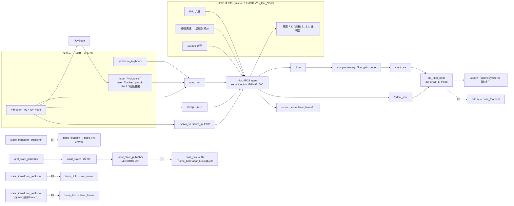

# F 區研究筆記：官方原始碼（18. Summary of program source code）分析

> 對象：Yahboom MicroROS-Pi5 車（Pi 5 Docker 內 ROS 2 Humble + ESP32 擴充板 micro-ROS 韌體）。
> 範圍：只讀 `src/` 內的原始碼，略過 `build/`、`install/`、`log/`。
> 來源資料夾（Git Bash）：`~/workspace/yahboom-microros-pi5/source-code/src/18. Summary of program source code/`（資料夾名有空白，指令要加引號）。
> 標記：【原始碼】= 直接讀檔所得；【推測】= 由程式推導、未在車上實測；【注意】= 與官方 PDF/直覺不一致之處。
> 相關筆記：課程對照見 `A-intro-control.md`、`B-vision.md`、`C1-lidar-slam-nav.md`、`E-esp32-microros.md`。

---

## 0. 先看這 7 個最重要的發現

1. **`yahboomcar_bringup_launch.py` 其實只啟動 4 件事**：IMU 互補濾波器、robot_localization EKF、`yahboomcar_description` 的 `description_launch.py`（robot_state_publisher + joint_state_publisher + 靜態 TF），以及 `base_link -> imu_frame` 靜態 TF。**它沒有啟動 `base_node`、沒有啟動光達驅動、沒有啟動相機。** 【原始碼】
2. **`odom -> base_footprint` 的 TF 是 EKF 發的**（`publish_tf: true`），不是 `base_node`。`base_node_X3` 只是把 `/odom_raw` 的位姿原樣轉成 TF，在單車 bringup 裡根本沒被呼叫（只有多機 `yahboomcar_bringup_multi_ctrl.launch.xml` 引用，而且引用的可執行檔名 `base_node` 與 CMake 產生的 `base_node_X3` 對不上）。
3. **原始碼裡沒有「里程計怎麼算」**：輪速積分在 ESP32 韌體裡，ROS 這端只收 `/odom_raw`（`nav_msgs/Odometry`）。`base_node` 裡的 `wheelbase`（預設 0.25）、`linear_scale_x/y` 宣告了卻完全沒用到。
4. **`/scan` 與 `/imu`、`/odom_raw` 都是 ESP32 韌體經 micro-ROS agent 發的**（見 `E-esp32-microros.md`：frame `laser_frame`、360 點、0.12~8.0 m、約 11 Hz），Docker 裡沒有任何光達驅動。**`laser_frame` 的 TF 只在 `yahboomcar_nav` 的建圖/導航 launch 裡才補上**，所以只跑 bringup 時 RViz 看 `/scan` 會缺 TF。
5. **URDF 的輪子 4 顆都是 `continuous`**（不是 fixed），但是：右側兩輪軸向是 `0 -1 0`、左側兩輪是 `0 1 0`；沒有 `base_footprint` link、沒有 `laser_frame`/`imu_frame` link（URDF 裡叫 `radar_Link`、`imu_Link`）、**沒有相機 link**、沒有任何 `<gazebo>` 外掛與 `<transmission>`；舵機關節 `jq1/jq2` 的 `effort=0 velocity=0`。要拿去 gz sim 必須補（第 7 節）。
6. **視覺追蹤（顏色、人臉、QR、單目 KCF）只轉動雲台舵機**（發布 `servo_s1`、`servo_s2`），`colorTracker` 完全不發 `/cmd_vel`；只有 `follow_line` 與 `qrTracker` 會發 `/cmd_vel` 讓車身動。
7. **`yahboomcar_bringup/setup.py` 的 console_scripts 有 8 個指向不存在的檔案**（`Mcnamu_driver_X3`、`Ackman_driver_R2`、`patrol_4ROS` 等，是 Jetson/麥克納姆/阿克曼舊車型遺留）；`yahboomcar_visual` 也有 3 個指向不存在的檔案。實際可用的只有 `calibrate_linear`、`calibrate_angular`、`patrol`。

---

## 1. 三個頂層腳本

### 1.1 `ros2_humble.sh`——進入車載 Docker 容器

```bash
xhost +
docker run -it --rm \
  --privileged=true --net=host \
  --env="DISPLAY" --env="QT_X11_NO_MITSHM=1" \
  -v /tem/.X11-unix:/tmp/.X11-unix \
  --security-opt apparmor:unconfined \
  -v /dev/input:/dev/input \
  -v /dev/video0:/dev/video0 \
  yahboomtechnology/ros-humble:4.0.3 /bin/bash /root/1.sh
```

| 項目 | 說明 |
| --- | --- |
| 映像 | `yahboomtechnology/ros-humble:4.0.3`（Humble） |
| `xhost +` | 允許容器連到主機的 X11 顯示（開 RViz / OpenCV 視窗用）；等於關掉 X 存取控制，**安全性較低**，只適合家用區網 |
| `--privileged`、`--net=host` | 容器可直接碰所有裝置；與主機共用網路，ROS 2 DDS 探索（與電腦同網域）才通 |
| `-v /tem/.X11-unix:/tmp/.X11-unix` | 【注意】來源路徑寫成 `/tem/`（應為 `/tmp/`），疑似官方筆誤；實際顯示靠 `DISPLAY` 環境變數與 `xhost +` 仍可能能動，**遇到容器內 GUI 開不起來先檢查這行** |
| `-v /dev/input` | 搖桿/手把裝置（`/dev/input/js0`）進容器 |
| `-v /dev/video0` | USB 相機進容器（colorHSV 等用 `cv.VideoCapture(0)`） |
| `--rm` | 結束即刪容器；**每次執行都是全新容器、新容器 ID**，要在同一容器開第二個終端要用 `docker ps` + `docker exec -it <ID> /bin/bash` |
| 啟動命令 `/root/1.sh` | 容器內腳本，不在這份原始碼中；A 筆記指出它會啟動手把節點（自動搶發 `/cmd_vel`，要手動控制時要先關掉） |

### 1.2 `start_agent_rpi5.sh`——啟動 micro-ROS agent

```bash
# WIFI（註解掉的備用）
#docker run -it --rm -v /dev:/dev -v /dev/shm:/dev/shm --privileged --net=host \
#  microros/micro-ros-agent:humble udp4 --port 8090 -v4
# serial（實際使用）
docker run -it --rm -v /dev:/dev -v /dev/shm:/dev/shm --privileged --net=host \
  microros/micro-ros-agent:humble serial --dev /dev/ttyUSB0 -b 921600 -v4
```

| 參數 | 意義 |
| --- | --- |
| 映像 `microros/micro-ros-agent:humble` | 官方 micro-ROS agent，把 ESP32 的 XRCE-DDS 資料翻成 ROS 2 DDS 話題 |
| `serial --dev /dev/ttyUSB0 -b 921600` | 序列傳輸；波特率 **921600**，必須與韌體設定（`config_robot.py` 的 `SERIAL_BAUDRATE`）一致 |
| `-v4` | 詳細度最高（4），會印出每筆通訊，除錯用 |
| `udp4 --port 8090` | WiFi 版（電腦/虛擬機版小車，`CAR_TYPE_COMPUTER`）；Pi5 版不用 |
| `-v /dev:/dev`、`-v /dev/shm` | 讓容器看得到序列裝置與共享記憶體 |

用法：車子電源開啟前/後先在 **Pi 5 本機**跑 `sh ~/start_agent_rpi5.sh`，看到 agent 等待後按擴充板 reset 鍵，agent 會顯示建立 session；之後才能在車載容器看到 `/YB_Car_Node` 與 `/cmd_vel` 等話題。

### 1.3 `config_robot.py`——經序列埠設定 ESP32 韌體參數

- 用 `pyserial` 開 `/dev/ttyUSB0`（**115200**，注意與 agent 的 921600 不同——這是韌體「設定模式」協定的速率），自訂封包：`0xFF, 0xF8(裝置ID), 長度, 指令碼, 資料..., 校驗和(sum % 256)`；回覆標頭 `0xFF, 0xF7`。
- 類別 `MicroROS_Robot`，可設定項目（`ORDER` 表）：

| 指令碼 | 名稱 | 方法 | 說明 |
| --- | --- | --- | --- |
| 0x01 / 0x02 | WIFI_SSID / WIFI_PASSWD | `set_wifi_config(ssid, passwd)` | WiFi 版用，重啟生效 |
| 0x03 / 0x04 | AGENT_IP / AGENT_PORT | `set_udp_config(ip, port)` | WiFi agent 位址（例 `[192,168,2,116]`, 8090） |
| 0x05 | CAR_TYPE | `set_car_type(0\|1)` | 0 = 電腦/虛擬機版（WiFi/UDP）；**1 = 樹莓派版（序列）** |
| 0x06 | DOMAIN_ID | `set_ros_domain_id(0..100)` | ROS_DOMAIN_ID，自動夾在 0~100 |
| 0x07 | SERIAL_BAUDRATE | `set_ros_serial_baudrate(n)` | 與 agent `-b` 一致 |
| 0x08 | SERVO_OFFSET | `set_pwm_servo_offset(id, off)` | 舵機 S1/S2 零位微調，範圍 [-6, 6] |
| 0x09 | MOTOR_PID | `set_motor_pid_parm(p,i,d)` | 馬達速度 PID，範圍 0.00~10.00（內部 ×100 存 int16） |
| 0x0A | IMU_YAW_PID | `set_imu_yaw_pid_parm(p,i,d)` | 以 IMU 航向修正直行的 PID |
| 0x0B | ROS_NAMESPACE | `set_ros_namespace(str)` | 多機時用；空字串 = 無 |
| 0x20 | REBOOT_DEVICE | `reboot_device()` | 寫 `0x5F 0x5F` 觸發重啟 |
| 0x21 | RESET_CONFIG | `reset_factory_config()` | 恢復出廠設定 |
| 0x50 / 0x51 | REQUEST_DATA / FIRMWARE_VERSION | `read_*()`、`print_all_firmware_parm()` | 讀回所有參數與韌體版本 |

- `__main__` 預設寫入的值（直接執行就會套用）：`CAR_TYPE_RPI5`、`domain_id=20`、`baudrate=921600`、`namespace=""`、舵機偏移 (1,0)、(2,0)、**馬達 PID (1, 0.2, 0.2)**、**IMU yaw PID (1, 0, 0.2)**；最後印出所有參數並提示「需重啟才生效」。
- 【注意】範例註解裡有 WiFi 帳密（`yahboom2` / `yahboom890729`），是官方預設示範值，勿當成你家的設定。
- 【注意】`set_wifi_config`/`set_ros_namespace` 用 `ORDER[...].append` 累加，同一個程式重複呼叫會越疊越長（小 bug，一次性使用沒問題）。
- 用法：確認 agent **沒在跑**（會佔 `/dev/ttyUSB0`），`python3 config_robot.py`，改完重啟擴充板。**`domain_id=20` 要與電腦/容器的 `ROS_DOMAIN_ID` 一致**，否則看不到話題。

---

## 2. 開機到能控車的啟動鏈

### 2.1 步驟

```
[Pi 5 本機]  sh start_agent_rpi5.sh           ← 保持開著；按擴充板 reset → 連線
[Pi 5 本機]  sh ros2_humble.sh                ← 進容器 #1（會執行 /root/1.sh，可能自啟手把節點）
[容器 #1]    ros2 launch yahboomcar_bringup yahboomcar_bringup_launch.py
[容器 #2]    ros2 run yahboomcar_ctrl yahboom_keyboard     （或手把 yahboomcar_joy_launch.py）
```

### 2.2 `yahboomcar_bringup_launch.py` 實際內容（逐項）

檔案開頭 `print("---robot_type = x3---")`（舊車型遺留字樣）。`LaunchDescription` 依序包含：

| # | 啟動項 | 來源套件 / 檔案 | 輸入話題 | 輸出話題 | TF |
| --- | --- | --- | --- | --- | --- |
| 1 | **IMU 互補濾波** `complementary_filter_gain_node`（`imu_complementary_filter`，`imu_ws` 內 imu_tools-humble） | `complementary_filter.launch.py`；參數 `do_bias_estimation=True`、`do_adaptive_gain=True`、`use_mag=False`、`gain_acc=0.01`、`gain_mag=0.01` | `/imu`（launch 把 `/imu/data_raw` 重映射成 `/imu`；`sensor_msgs/Imu` 6 軸原始） | `/imu/data`（含姿態四元數） | 不發 TF（`publish_tf` 預設 false） |
| 2 | **EKF** `ekf_filter_node`（`robot_localization`） | 同名 `ekf.launch.py`，參數 `robot_localization/params/ekf.yaml` | `/odom_raw`（`nav_msgs/Odometry`）、`/imu/data` | `/odometry/filtered` → **重映射成 `/odom`** | **發 `odom -> base_footprint`**（`publish_tf: true`） |
| 3 | **description_launch.py**（`yahboomcar_description`）：`robot_state_publisher` | URDF `urdf/MicroROS.urdf`（用 `xacro` 展開） | `/joint_states` | `/robot_description` | 依 URDF 發 `base_link -> zq/yq/yh/zh_Link, imu_Link, radar_Link, jq1_Link, jq2_Link` |
| 4 | 同上：`joint_state_publisher` | — | — | `/joint_states`（全 0；沒有真實關節回授） | — |
| 5 | 同上：靜態 TF `tf2_ros static_transform_publisher` | 參數 `0 0 0.05 0 0 0 base_footprint base_link` | — | — | **`base_footprint -> base_link`，z = +0.05 m** |
| 6 | 靜態 TF `base_link_to_base_imu` | 參數 `-0.002999 -0.0030001 0.031701 0 0 0 base_link imu_frame` | — | — | **`base_link -> imu_frame`**（數值與 URDF `imu_Joint` 相同，但 URDF 的 link 叫 `imu_Link`，`imu_frame` 只存在於這個靜態 TF） |

【注意】

- 檔案裡定義了 `imu_filter_config`（指向 `param/imu_filter_param.yaml`，是 **Madgwick** 濾波的參數）但**完全沒被使用**；實際跑的是 complementary filter。多機版（`yahboomcar_multi`）才用 `imu_filter_madgwick`。
- **沒有 base_node**、沒有光達/相機驅動、沒有 `laser_frame` TF（見下方）。
- EKF 在此設定下是：位置 x,y、航向 yaw、速度 vx,vy、角速度 vyaw 取自 `/odom_raw`；**IMU 只取 yaw 與 yaw 角速度**（`imu0_relative: true`，所以 IMU 的 yaw 是相對初始值）。

### 2.3 EKF 參數重點（`robot_localization/params/ekf.yaml`）

```yaml
frequency: 30.0          # 30 Hz 輸出
two_d_mode: true         # 只估平面 (x, y, yaw)
publish_tf: true
odom_frame: odom
base_link_frame: base_footprint
world_frame: odom
odom0: /odom_raw
odom0_config: [T,T,F,  F,F,T,  T,T,F,  F,F,T,  F,F,F]   # x y | yaw | vx vy | vyaw
imu0: /imu/data
imu0_config:  [F,F,F,  F,F,T,  F,F,F,  F,F,T,  F,F,F]   # yaw | vyaw
imu0_relative: true
imu0_remove_gravitational_acceleration: true
```

（15 個布林依序為 x,y,z, roll,pitch,yaw, vx,vy,vz, vroll,vpitch,vyaw, ax,ay,az。）
`process_noise_covariance` 對角線約 0.01~0.06；`initial_estimate_covariance` 全部 1e-9。

### 2.4 `laser_frame` 在哪裡補

下列 launch 都各自帶一個靜態 TF `base_link_to_base_laser`：`-0.0046412 0 0.094079 0 0 0 base_link laser_frame`：
`yahboomcar_nav/launch/map_gmapping_launch.py`、`map_cartographer_launch.py`、`navigation_dwb_launch.py`（以及多機版加 `robot1/` `robot2/` 前綴）。**只跑 bringup 不跑這些 → 沒有 `laser_frame`**。

### 2.5 資料流圖



---

## 3. 套件逐一說明

> 工作空間 `yahboomcar_ws/src/`（共 16 個套件資料夾）。容器內路徑為 `/root/yahboomcar_ws/src/...`。課程編號沿用官方 PDF 資料夾（05 Robot control、06 ROS+OpenCV、07 Mediapipe、08 Robot visual interaction、09 Lidar、10 Multi-machine、14 ROS2 basic）。

### 3.1 `yahboomcar_bringup`——底層啟動、巡邏、校正

- **launch**：`yahboomcar_bringup_launch.py`（見第 2 節）。
- **param**：`imu_filter_param.yaml`（`imu_filter_madgwick`：`fixed_frame: base_link`、`use_mag: false`、`publish_tf: false`、`world_frame: enu`、`orientation_stddev: 0.0`，**單車 launch 沒用到**）；`rviz/yahboomcar.rviz`。
- **可用的 console_scripts**（檔案存在）：`calibrate_linear`、`calibrate_angular`、`patrol`。另有 `test.py`、`untitled.py`、`transform_utils.py`（輔助）。
- **setup.py 中指向不存在檔案的 8 項**：`Mcnamu_driver_X3`、`Mcnamu_driver_x1`、`patrol_4ROS`、`Ackman_driver_R2`、`calibrate_linear_R2`、`calibrate_angular_R2`、`patrol_4ROS_R2`、`patrol_a1_R2`。`ros2 run yahboomcar_bringup Mcnamu_driver_X3` 這類指令在這個版本一定失敗（驅動已移到 ESP32 韌體）。
- 對應課程：9.4 光達巡邏（`patrol`）、里程計校正（`calibrate_*`，05 Robot control 一帶）。

**`patrol.py`（節點 `YahboomCarPatrol`）核心**：

- 靠 **TF 查 `odom -> base_footprint`** 取得目前位置（`tf_buffer.lookup_transform`），不訂閱 `/odom`。
- `advancing(距離)`：累積歐氏距離 × `LineScaling`，與目標誤差小於 `LineTolerance` 就停；否則持續發 `linear.x = Linear`。
- `Spin(角度)`：每個週期取 odom yaw 的差值 × `RotationScaling` 累加到 `turn_angle`，誤差小於 `RotationTolerance` 停；方形/三角形用 `angular.z = copysign(Angular, error)`，圓形則邊走邊轉（`angular = Linear*circle_adjust/Length`）。
- 指令由參數 `Command` 切換：`LengthTest`、`Circle`、`Square`、`Triangle`；`Switch` 開關；`Set_loop` 重複。方形 = 前進 `Length` → 轉 90° → 重複 4 次（程式用 `index` 狀態機一步一步做）。
- 預設參數（`declare_parameter`）：`Linear=0.2`、`Angular=0.9`、`Length=0.5`、`ResponseDist=0.6`、`LaserAngle=20`、`RotationTolerance=0.25`、`LineTolerance=0.05`、`circle_adjust=2.0`。
- 發 `/cmd_vel`、`/beep`，訂閱 `/JoyState`。
- 【注意】避障停車依賴 `self.warning > 10`，但訂閱 `/scan` 的那行在此版本被註解掉，`warning` 恆為 1 → **此版本巡邏不會因障礙停下來**（蜂鳴器也不會響）。

**`calibrate_linear.py` / `calibrate_angular.py`**：發 `cmd_vel` 讓車走 `test_distance`（預設 1.0 m）／轉一圈，用 TF 量實際走了多少，`odom_linear_scale_correction`（預設 1.5）縮放後與目標比較，`start_test` 參數開始。用法：量出實際距離 → 反推比例 → 回填到韌體（輪徑/輪距）或 EKF/ROS 端。

### 3.2 `yahboomcar_base_node`（C++，CMake）

- **目標**：`base_node_X3`（`add_executable(base_node_X3 src/base_node_X3.cpp)`）。
- 節點名 `base_node`；訂閱 **`odom_raw`**（`nav_msgs/Odometry`，QoS depth 50）；每收到一筆就把 `pose.pose.position/orientation` 原樣包成 `TransformStamped` 發 TF：`odom_frame`（預設 `odom`）→ `base_footprint_frame`（預設 `base_footprint`）。
- 參數：`wheelbase`(0.25)、`odom_frame`、`base_footprint_frame`、`linear_scale_x`(1.0)、`linear_scale_y`(1.0)、`pub_odom_tf`(false)。**`wheelbase`、`linear_scale_*`、`pub_odom_tf` 都只讀進變數，沒有任何計算使用**；`vel_dt_`、`last_vel_time_` 同樣沒實際用途。
- **結論**：這個版本的「里程計」= 韌體算好的 `/odom_raw`。ROS 端沒有輪速積分程式。若要做輪距/輪徑校正，要改韌體參數或在 EKF 前處理。
- 【注意】單車 bringup 不啟動它（EKF 已發同一條 TF，兩者同時發會 TF 衝突）。`yahboomcar_bringup_multi_ctrl.launch.xml` 用 `exec="base_node"`，但 CMake 產生的是 `base_node_X3`，**多機 launch 此處會找不到執行檔**。

### 3.3 `yahboomcar_ctrl`——鍵盤與手把

- **console_scripts**：`yahboom_joy`、`yahboom_keyboard`、`yahboom_joy_R2`（阿克曼 R2 車型遺留）。
- **launch**：`yahboomcar_joy_launch.py` = 啟動 `yahboomcar_ctrl/yahboom_joy` + `joy/joy_node`。
- 對應課程：05 Robot control（鍵盤、手把控制）。

**`yahboom_keyboard`（節點 `yahboom_keyboard_ctrl`）**：

- 發布 `cmd_vel`（`geometry_msgs/Twist`，depth 1000）；參數 `linear_speed_limit`(1.0)、`angular_speed_limit`(5.0)。
- 初始 `speed=0.2`、`turn=1.0`。按鍵表（`moveBindings` 為 (前後, 轉向)）：

```
   u    i    o        i=(1,0) 前進   ,=(-1,0) 後退
   j    k    l        j=(0,1) 左轉   l=(0,-1) 右轉
   m    ,    .        u/o 前進+左/右轉   m/. 後退+轉
q/z 速度全部 ±10%   w/x 只改線速度   e/c 只改角速度
t 切換「前後鍵發 linear.x 或 linear.y」   s 暫停鍵盤輸出   空白鍵 強制停
```

- 核心：用 `termios` 設 raw 模式，`select` 等 0.1 秒讀一個字元；**沒按鍵連續超過 4 次（約 0.5 秒）就把 (x, th) 歸 0**——這是「放開就停」的安全機制。
- 【注意】說明文字提到 `k` 是強制停，但程式裡 `k` 不在 `moveBindings`，會走「其他鍵 → 計數歸零」流程（效果是約 0.5 秒後停）。

**`yahboom_joy`（節點 `joy_ctrl`）**：

- 訂閱 `joy`（`sensor_msgs/Joy`）；發布 `cmd_vel`、`beep`(UInt16)、`JoyState`(Bool)、`servo_s1`、`servo_s2`(Int32)、`move_base/cancel`。
- **`buttons[7]` = 切換「手把接管」旗標 `Joy_active` 並發布 `/JoyState`**（官方稱 R1/啟動鍵；A 筆記說「要先按 R1 才有輸出」）。`Joy_active == False` 時，手把推桿**不會**發 `/cmd_vel`。
- 速度：`linear.x = 搖桿軸1 × xspeed_limit(1.0) × linear_Gear(1/3)`，`angular.z = 軸2 × angular_speed_limit(5.0) × angular_Gear(1/4)`，**最大約 0.33 m/s、1.25 rad/s**；死區 `|axis|<0.2` 視為 0；`linear.y` 固定 0（單車是差速，不橫移）。
- `buttons[11]` 切換蜂鳴器；`buttons[1]/[3]` 舵機 S1 ±1 度（限 ±90）；`buttons[0]/[4]` 舵機 S2 ±1 度（限 -90~20）；啟動時先發舵機初始角 S1=0、S2=-60。
- **`/JoyState` 是整個系統的「手把優先」機制**：所有自動程式（避障、跟隨、巡邏、視覺追蹤）都訂閱它，`True` 時讓出控制權。
- 檔內 `user_pc()`（含 y 軸、檔位切換、RGB 燈）為其他車型保留，目前入口只呼叫 `user_jetson()`。

### 3.4 `yahboomcar_description`——URDF 與顯示

見第 4 節。

### 3.5 `yahboomcar_laser`——光達避障/跟隨/警衛（9.1~9.3）

console_scripts：`laser_Avoidance`、`laser_Tracker`、`laser_Warning`。共用 `common.py`：`SinglePID(P=0.1,I=0,D=0.1)`，`pid_compute(target, current)`：`error = target-current`；`integral += error`；`derivative = error - prevError`；輸出 `Kp*error + Ki*integral + Kd*derivative`（**離散、不乘 dt**）。三個程式共通：訂閱 `/scan`(`LaserScan`, depth 1)、`/JoyState`；發布 `/cmd_vel`；參數 `Switch`（`True` = 暫停，不是「開啟」！——程式在 `Switch==True` 時停車並 return）、結束時 `exit_pro()` 用 `os.system("ros2 topic pub --once /cmd_vel ...")` 補一個零速度。每個迴圈把 `angle = angle_min + angle_increment*i` 轉成度、壓到 -180~180。

【注意】C1 筆記說 `Switch` 是「功能開關（要打開才會動）」，**原始碼是相反**：預設 `False` 就直接動；設 `True` 才暫停。

**`laser_Avoidance`（避障，9.1）**

- 參數：`linear=0.3`、`angular=1.0`、`LaserAngle=45.0`、`ResponseDist=0.55`、`Switch=False`。
- 白話：把前方切成三區——左 `20°<angle<LaserAngle`、右 `-LaserAngle<angle<-20°`、前 `|angle|≤20°`；每區數「距離 < `ResponseDist×1.5`（≈0.825 m）」的雷射點，**點數 > 10 才算那區有障礙**（濾掉雜訊）。

```python
if self.front_warning > 10 and self.Left_warning > 10 and self.Right_warning > 10:   # 三面都有
    twist.linear.x = self.linear; twist.angular.z = -self.angular   # 右轉
...
elif self.front_warning <= 10 and self.Left_warning <= 10 and self.Right_warning <= 10:
    twist.linear.x = self.linear; twist.angular.z = 0.0             # 沒障礙：直走
```

  8 種 (前,左,右) 組合都有對應動作；右邊有障礙→左轉、左邊有障礙→右轉；其餘多為右轉。**轉的時候 `linear.x` 仍是 0.3（邊走邊轉）**，每次動作後 `sleep(0.2~0.5)`（在回呼函式裡睡眠，會擋住後續 `/scan` 處理）。

- 【注意】「前＋左有障礙、右沒有」那一支（`print('4...')`）的 `publish` 被註解掉，實際只 sleep 不動。

**`laser_Tracker`（跟隨，9.2）**

- 參數：`priorityAngle=10.0`、`LaserAngle=45.0`、`ResponseDist=0.55`、`Switch=False`；內建 PID：`lin_pid=(2.0,0,2.0)`、`ang_pid=(3.0,0,5.0)`。
- 白話：先看正前方 ±`priorityAngle` 內、距離在 `ResponseDist+0.5` 以內的點，有就取其中最近的；沒有再看 ±`LaserAngle` 內全部點找最近的——**「最近的東西就是目標」**。然後：
  - 距離：`linear.x = -lin_pid(ResponseDist, minDist)`（目標距離 0.55 m：太遠往前、太近後退；`|minDist-0.55|<0.1` 視為已到位不動）。
  - 方位：`angular.z = ang_pid(minDistID/48, 0)`（角度除以 48 當歸一化常數——經驗值，C1 筆記也標為待釐清）；`|angular|<0.1` 設 0。

**`laser_Warning`（警衛，9.3）**

- 參數：`LaserAngle=45.0`、`ResponseDist=0.3`、`Switch=False`；`ang_pid=(3,0,5)`。
- 白話：找 ±`LaserAngle` 內最近的點，車身**原地轉向對準它**（只有 `angular.z`，無前進）；最近距離 ≤ `ResponseDist` 時發 `/beep`(`UInt16`) = 1 響蜂鳴器，否則發 0。
- 【注意】`exit_pro()` 裡組好了關蜂鳴器的指令（`cmd3/cmd4`）卻沒執行（`cmd = cmd1+cmd2` 寫了兩次）——結束時蜂鳴器可能還在響。

### 3.6 `yahboomcar_nav`——建圖與導航（9.5~9.9）

見第 5 節。

### 3.7 `yahboomcar_visual`——影像與 AR（06 ROS+OpenCV）

- **console_scripts**：`simple_AR`、`pub_image`、`astra_rgb_image`、`astra_color_point`；【注意】`laser_to_image`、`astra_depth_image`、`astra_image_flip` 三項指向不存在的檔案。
- `pub_image`：訂閱 `/image_raw` → 縮成 640×480 → 發布 `/image`（`cv_bridge`）。`astra_rgb_image`：訂閱 `image_raw` 並 `cv.imshow`。`astra_color_point`：用 `message_filters.ApproximateTimeSynchronizer` 同步 `/camera/color/image_raw` 與 `/camera/depth/image_raw`（深度相機用，**本車單目 USB 相機沒有深度，此節點用不到**）。
- `simple_AR`（399 行）：開 `cv.VideoCapture(0)`，用 `Marker/*.xml` 做標記辨識/疊圖，結果發布 `/simpleAR/camera`（Image）；按 `f` 切換效果。
- 其他檔案：`astra.yaml`（相機內參 640×480，`camera_matrix` fx≈524、fy≈557；為標定範例值）、`detection/`（SSD MobileNet v2 COCO、OpenPose 模型與 `target_detection.py`，用 `cv.dnn.readNet`）、`simple_qrcode/`（QR 產生/解析）。
- 【注意】`colorTracker` 的 `depth_img_Callback` 名稱帶 depth，實際訂閱的是 `/image_raw`（RGB）；Astra 深度相機時代遺留命名（套件名 `yahboomcar_astra`）。

### 3.8 `yahboomcar_astra`——顏色追蹤、人臉、QR、巡線（08 Robot visual interaction）

console_scripts：`colorHSV`、`colorTracker`、`qrTracker`、`mono_Tracker`、`face_fllow`（官方拼成 fllow）、`follow_line`。launch：`colorTracker_X3.launch.py`（引用不存在的 `yahboomcar_bringup_X3_launch.py` 與已淘汰的 `node_executable` 參數，**不能用**）。

**顏色追蹤（`colorHSV` + `colorTracker`，兩個節點要一起開）**

- `colorHSV`（節點 `Color_Identify`）：自己 `cv.VideoCapture(0)` 抓相機（所以容器要掛 `/dev/video0`），把畫面發布成 `/image_raw`；滑鼠框選 ROI → `Roi_hsv()` 取 ROI 內 H/S/V 的最小/最大當範圍（存到 `colorHSV.text`，參數 `Hmin/Smin/Vmin/Hmax/Smax/Vmax`，預設 0,85,126~9,253,253，偏紅色）；之後每幀：BGR→HSV → `cv.inRange` 做遮罩 → 灰階 → 形態學閉運算（5×5）→ 二值化 → `findContours`（外輪廓）→ **取面積最大的輪廓** → `minAreaRect` → `minEnclosingCircle` 得到圓心 (x,y) 與半徑；發布 `yahboomcar_msgs/Position` 到 **`/Current_point`**（`anglex=圓心x`, `angley=圓心y`, `distance=半徑`——欄位名被借用）。
- `colorTracker`（節點 `ColorTracker`）：訂閱 `/Current_point`、`/image_raw`、`/JoyState`；每次收到影像就以畫面中心 (320, 240) 當設定點，算 `[x_Pid, y_Pid] = simplePID.update([cx-320, cy-240])`，然後**累加到舵機角度**：

```python
self.PWMServo_X -= x_Pid      # img_flip=False 時
self.PWMServo_Y += y_Pid
# 限幅：X 在 -90~90，Y 在 -90~20
pub_Servo1.publish(Int32(int(PWMServo_X))); pub_Servo2.publish(Int32(int(PWMServo_Y)))
```

  PID 參數：`linear_Kp=20, Ki=0, Kd=2`（再除以 `scale=1000`），`angular_*` 宣告了但未用於輸出。**它轉動的是雲台，不是車輪。**

- `mono_Tracker`（KCF/CSRT 等 OpenCV Tracker，`astra_common.Tracker` 類別）、`face_fllow`（Haar 人臉 `haarcascade_frontalface_default.xml`，PID 初值 (20,0,1)）：同樣只驅動 `servo_s1/s2`。
- `qrTracker`：偵測 QR code，會發 `/cmd_vel`、`/beep`、舵機。
- **`follow_line`（巡線）**：用同樣的 HSV 找線的色塊，取輪廓中心 x，`PID.update([(point_x-320)/16, 0])` 當 `angular.z`（參數 `Kp=60, Ki=0, Kd=20`，`scale=1000`，`linear=0.18`），`|point_x-320|<40` 視為居中不轉；同時訂閱 `/scan`，前方 `LaserAngle=30` 內障礙 `ResponseDist=0.55` 以內多於 10 個點就停車並響蜂鳴器；`/JoyState` True 時讓出。
- 鍵盤操作（視窗內）：空白鍵開始追蹤、`i` 回識別、`r` 重設、`q` 離開；滑鼠框選目標。

### 3.9 `yahboomcar_mediapipe`——手勢/姿勢（07 Mediapipe、部分 08）

- console_scripts：`01_HandDetector`、`02_PoseDetector`、`03_Holistic`、`04_FaceMesh`、`05_FaceEyeDetection`、`test_msg`、`HandCtrl`、`RobotCtrl`、`control_shape`、`FingerCtrl`。另有 06~11 號腳本檔，需 `python3` 直接跑（`scripts/` 子資料夾），沒註冊成 `ros2 run`。
- `media_library.py` 封裝 MediaPipe 偵測（手、姿勢、臉）。`HandCtrl`/`RobotCtrl`/`FingerCtrl`/`control_shape` 都只建立 `servo_s1`、`servo_s2` 發布者（雲台/手臂式舵機控制）；**`HandCtrl` 的 `hand_threading` 另外透過 `media_ros.pub_vel` 發速度**（五指全開 +0.3 前進；握拳 -0.3 後退；食指 `angular.z=+0.5`；食指+中指 `-0.5`；停 0.5 秒）。
- `launch/mediapipe_points.launch.py` 引用不存在的 `yahboomcar_point` 套件、且 RViz 路徑寫死 `/home/nx-ros2/...`，**不可用**。

### 3.10 `yahboomcar_multi`——多機（10 Multi-machine course）

- console_scripts：`queue`（`Queue_Broadcaster`，依 `/team` 字串與參數 `Team`(vertical/…)、`Distance` 發 TF 做隊形）、`listenline`（跟隨 robot1 的 TF 控制 `/robot2/cmd_vel`）、`multi_keyboard_ctrl`、`multi_joy_ctrl`。
- launch：`bringup_launch.py`、`yahboomcar_bringup_multi*.launch.xml`（Madgwick + EKF + 靜態 TF，皆加 `robot1/` `robot2/` 命名空間與 frame 前綴）、`lidar_multi`、`laser_bringup_multi`、`map_server*`、`robot1/2_amcl_launch.py`、`robot1/2_nav_launch.py`、`robot1/2_navigation_dwb_launch.py`、`nav2_multi.launch.xml`、`test_tf_launch.py`。
- param：`ekf_robot1/2.yaml`、`ekf_yahboom.yaml`、`robot1/2_amcl_params.yaml`、`robot1/2_nav_params.yaml`、`navigate_w_replanning_and_recovery.xml`（行為樹）、`imu_filter_param.yaml`。maps：`yahboom_map.yaml`。
- 初學者階段可略過，需要多車再細讀。【注意】`yahboomcar_bringup_multi_ctrl.launch.xml` 引用的 `Mcnamu_driver`、`base_node` 在此版本不存在/名稱不符。

### 3.11 `yahboomcar_msgs`——自訂訊息

見第 6 節。

### 3.12 `robot_localization`

上游 `robot_localization`（EKF/UKF）的本地副本，**唯一被客製的是 `launch/ekf.launch.py` 與 `params/ekf.yaml`**：`ekf.launch.py` 啟動 `ekf_node`（節點名 `ekf_filter_node`），並 `remappings=[('/odometry/filtered','/odom')]`。`ukf.yaml`、`navsat_transform.yaml`、`dual_ekf_navsat_example.yaml` 是上游範例，不使用。

### 3.13 `laserscan_to_point_publisher`（App 建圖/導航用）

- console_scripts：`laserscan_to_point_publisher`。節點（程式內名稱寫成 `robot_pose_publisher`）訂閱 `/scan`，發布 **`/scan_points`（`nav_msgs/Path`）**：把每個距離轉成 (x,y)（`x = d*cos(angle+135)`, `y = d*sin(angle+135)`——【注意】`+135` 是直接加在弧度上，疑似度/弧度混用的小錯；且呼叫時 `angle_min` 被誤傳成 `angle_increment`）。給手機 App 畫雷射點用。

### 3.14 `robot_pose_publisher_ros2`（C++）

- 目標 `robot_pose_publisher`：定時查 TF `map_frame -> base_frame`，發布 `robot_pose`（`PoseStamped`，`is_stamped=true`）。launch 傳參 `use_sim_time: True`（【注意】實車用 True 會讓時間來源錯誤，疑似官方沿用模擬設定）、`map_frame: map`、`base_frame: base_link`。給 App 顯示車子位置。

### 3.15 `yahboom_app_save_map` + `yahboom_web_savmap_interfaces`

- `server`（`yahboom_app_save_map`）：建立服務 **`yahboomAppSaveMap`**（型別 `yahboom_web_savmap_interfaces/srv/WebSaveMap`：請求 `string mapname`，回應 `string response`），收到後把地圖資訊寫入 SQLite `data/xgo.db` 的 `xgo_map` 表（`map_name`, `map_id`=MD5, `map_path`），並呼叫 `ros2 run nav2_map_server map_saver_cli -f /root/yahboomcar_ws/src/yahboomcar_nav/maps/<mapname>` 存圖。`client` 是測試用客戶端。
- 【注意】路徑寫死 `/root/yahboomcar_ws/...`，只能在官方容器內用。

### 3.16 `yahboomcar_ros2_ws`——ROS 2 基礎課範例（14 ROS2 basic course）

資料夾：`yahboomcar_ros2_ws/yahboomcar_ws/src/`，共 8 個套件（皆 `pkg_*`）：

| 套件 | 內容 | 可執行檔 / launch |
| --- | --- | --- |
| `pkg_helloworld_py` | 最小節點 | `helloworld`；`launch/single_node_launch.py` |
| `pkg_topic` | 話題發布/訂閱 | `publisher_demo`、`subscriber_demo`；launch：`complex_launch.py/.xml/.yaml`、`include_launch.py`、`multi_node_launch.py`、`remap_name_launch.py`（同一個 launch 的 Python/XML/YAML 三種寫法） |
| `pkg_service` | 服務 | `server_demo`、`client_demo`（用 `pkg_interfaces/srv/Add`） |
| `pkg_action` | 動作 | `action_server_demo`、`action_client_demo`（用 `pkg_interfaces/action/Progress`） |
| `pkg_param` | 參數 | `param_demo` |
| `pkg_tf` | TF 與小烏龜 | `turtle_tf_broadcaster`、`turtle_following`；`launch/turtle_following.launch.py` |
| `pkg_interfaces` | 自訂介面 | `msg/Person.msg`（`string name; int32 age; float64 height`）、`srv/Add.srv`（`int32 num1, num2 → int32 sum`）、`action/Progress.action`（`int64 num → int64 sum, float64 progress`） |
| `pkg_metapackage` | 彙總套件（只有 package.xml） | — |

這一包很適合直接當「ROS 2 基礎」教材的程式範例（話題、服務、動作、參數、TF、launch 三種格式、自訂介面）。

### 3.17 `gmapping_ws`、`imu_ws`

- `gmapping_ws/src`：`slam_gmapping`（ROS 2 移植版）+ `openslam_gmapping`。launch：`slam_gmapping.launch.py`（啟動 `slam_gmapping` 節點，參數 `params/slam_gmapping.yaml`）。參數重點：`base_frame: base_footprint`、`odom_frame: odom`、`map_frame: map`、`delta: 0.05`（地圖解析度 5 cm）、`maxRange: 6.0`、`maxUrange: 4.0`、`particles: 30`、`linearUpdate: 1.0`、`angularUpdate: 0.5`、`map_update_interval: 5.0`、地圖範圍 ±10 m、`minimum_score: 0`。
- `imu_ws/src/imu_tools-humble`：上游 imu_tools（`imu_complementary_filter`、`imu_filter_madgwick`、`rviz_imu_plugin`）。bringup 用到的是 `imu_complementary_filter`：訂閱 `imu/data_raw`（被重映射為 `/imu`），發布 `imu/data`。

---

## 4. URDF：`yahboomcar_description/urdf/MicroROS.urdf`

### 4.1 檔案概況

- `<robot name="micro4.0">`，SolidWorks 匯出；網格 `package://yahboomcar_description/meshes/*.STL`（10 個）。
- 同資料夾還有 `MicroROS_robot1.urdf`、`MicroROS_robot2.urdf`（多機命名空間版）、`yahboomcar_robot2.urdf`。
- **沒有** `<gazebo>`、`<transmission>`、`<sensor>`、`<ros2_control>`、相機 link、`base_footprint` link。

### 4.2 link / joint 樹（單位 m，相對父 link 的 `origin xyz`，rpy 全為 0）

```
base_link                      質量 0.2226 kg，網格 base_link.STL
├─ zq_Link  (zq_Joint, continuous, 軸 0 1 0)   xyz=( 0.0455,  0.0675, -0.02125)  左前輪
├─ yq_Link  (yq_Joint, continuous, 軸 0 -1 0)  xyz=( 0.0455, -0.0675, -0.02125)  右前輪
├─ yh_Link  (yh_Joint, continuous, 軸 0 -1 0)  xyz=(-0.0495, -0.0675, -0.02125)  右後輪
├─ zh_Link  (zh_Joint, continuous, 軸 0 1 0)   xyz=(-0.0495,  0.0675, -0.02125)  左後輪
├─ imu_Link   (imu_Joint,   fixed)             xyz=(-0.002999, -0.0030001, 0.031701)
├─ radar_Link (radar_Joint, fixed)             xyz=( 0, 0, 0.078933557)         光達
└─ jq1_Link   (jq1_Joint, revolute, 軸 0 0 1, ±1.57 rad)   xyz=(0.064, 0, 0.014)   雲台水平（對應舵機 S1）
   └─ jq2_Link (jq2_Joint, revolute, 軸 (0.0037845, -0.99999, 0), ±1.57 rad)
                                              xyz=(0.016864, 8.4892e-5, 0.023959)   雲台俯仰（對應舵機 S2）
```

命名：`z`=左（左前 zq、左後 zh）、`y`=右（右前 yq、右後 yh）、`q`=前、`h`=後（漢語拼音縮寫：左 zuo / 右 you / 前 qian / 後 hou）。`jq` = 舵機。

### 4.3 質量與慣量

| link | 質量 (kg) | 備註 |
| --- | --- | --- |
| base_link | 0.2226 | 慣量 ixx 1.6e-4, iyy 1.76e-4, izz 3.0e-4 |
| 每顆輪 ×4 | 0.01410 | 繞轉軸（y）iyy 4.68e-6，其餘約 2.66e-6 |
| imu_Link | 0.01321 | |
| radar_Link | 0.03847 | |
| jq1_Link | 0.01151 | |
| jq2_Link | 0.01333 | |
| **合計** | **約 0.36 kg** | 【推測】遠小於實車（含電池、Pi 5、馬達）；URDF 只含外殼/感測器估重 |

### 4.4 尺寸（由網格 STL 的包圍盒實測，已用 Python 解析 STL 頂點）

| 項目 | 數值 |
| --- | --- |
| 車身 `base_link` 網格包圍盒 | x: -0.0806 ~ +0.0845（**長 0.165 m**）；y: ±0.0665（**寬 0.133 m**）；z: -0.0345 ~ +0.043（**高 0.0775 m**） |
| **輪徑** | 輪網格 x、z 皆為 ±0.024 → **直徑 0.048 m、半徑 0.024 m** |
| **輪寬** | 0.0215 m（y 方向 -0.009 ~ +0.0125 / -0.0125 ~ +0.009） |
| **輪距（左右輪中心距，track）** | 0.0675 × 2 = **0.135 m** |
| **軸距（前後軸距，wheelbase）** | 0.0455 − (−0.0495) = **0.095 m** |
| 輪軸高度 | 輪心在 base_link z = -0.02125；輪底 z = -0.02125 - 0.024 = **-0.04525** |
| 地面高度 | `base_footprint -> base_link` 靜態 z = +0.05 → 輪底離 `base_footprint` 地面 **約 4.75 mm**（URDF 與 TF 不完全吻合，模擬時要修） |
| 光達 `radar_Link` | 網格 z -0.033 ~ 0（原點在頂端），直徑約 0.038 m；安裝原點 z = +0.0789 → 光達本體佔 z 0.046~0.079 |
| IMU `imu_Link` | 網格約 0.088 × 0.056 × 0.019（其實是一塊板子） |

- **輪徑／輪距是由 CAD 網格推得**；`base_node` 的 `wheelbase=0.25` 是舊車型遺留且未使用，**不要拿它當輪距**。實際里程計用的輪徑、輪距在 ESP32 韌體裡（見 E 筆記），建議 `calibrate_linear` 實測驗證。
- 【推測】驅動型式：四輪驅動、滑移轉向（skid-steer）/差速，不是麥克納姆——`yahboom_joy` 固定 `linear.y = 0`，Nav2 `max_vel_y: 0`，AMCL 用 `DifferentialMotionModel`（鍵盤 `t` 鍵雖可發 `linear.y`，車不一定能執行）。

### 4.5 光達與相機位置

| 感測器 | URDF | 實際 TF（launch 靜態） | 差異 |
| --- | --- | --- | --- |
| 光達 | `radar_Link`：`base_link` 前 0、左 0、上 **0.0789** | `laser_frame`：`(-0.0046412, 0, 0.094079)`，無旋轉 | **frame 名稱不同（`radar_Link` vs `laser_frame`）且 z 差 15 mm**；導航、建圖用的是 `laser_frame`。模擬時以 `laser_frame` 數值為準 |
| IMU | `imu_Link`：`(-0.002999, -0.0030001, 0.031701)` | `imu_frame`：同數值 | 名稱不同，數值一致 |
| 相機 | **URDF 無相機 link** | 無 | 相機裝在 `jq2_Link`（俯仰雲台）上；【推測】相機約在 base_link 前方 0.08 m、高 0.04 m 附近（jq1 原點 0.064 + jq2 原點 0.0169；z 0.014 + 0.024），須自行量測並補 `camera_link`/`camera_optical_frame` |

### 4.6 `display_launch.py` 怎麼用

`yahboomcar_description/launch/display_launch.py`（不啟動任何真實硬體，只看模型）：

- 啟動 `robot_state_publisher`（讀 `MicroROS.urdf`，`model` 參數可換成其他 URDF）、**`joint_state_publisher_gui`**（滑桿拉關節，如雲台 jq1/jq2、輪子）、靜態 TF `base_footprint -> base_link`（z 0.05）。
- **它不開 RViz**。使用方式：

  ```bash
  ros2 launch yahboomcar_description display_launch.py
  ros2 run rviz2 rviz2        # 另開，Fixed Frame 選 base_footprint，Add > RobotModel（Description Topic: /robot_description）
  ```

  或直接用 `yahboomcar_bringup/rviz/yahboomcar.rviz`。
- `description_launch.py`（bringup 用的）與它差別：用 `joint_state_publisher`（無 GUI）。
- 另有 `yahboomcar_nav/launch/display_launch.py`：**這個才是開 RViz**（載入 `yahboomcar_nav/rviz/view.rviz`），兩者同名，容易混淆。
- 【注意】`yahboomcar_description/setup.py` 以 `glob('launch/*launch.py')` 安裝 launch，檔名只要以 `launch.py` 結尾（含 `description_launch.py`、`display_launch.py`、`*.launch.py`）都會裝進去；`.xml` 格式的 launch 不會被這個 glob 收。

---

## 5. `yahboomcar_nav`——建圖與導航

### 5.1 launch 清單

| launch | 作用 |
| --- | --- |
| `display_launch.py` | 開 RViz（`rviz/view.rviz`，參數 `rvizconfig` 可換） |
| `map_gmapping_launch.py` | **gmapping 建圖**：include `slam_gmapping.launch.py` + 靜態 TF `base_link -> laser_frame` |
| `map_cartographer_launch.py` | **Cartographer 建圖**：include `cartographer_launch.py` + 靜態 TF `laser_frame` |
| `cartographer_launch.py` | 啟動 `cartographer_node`（設定目錄 `params/`、檔名 `lds_2d.lua`）+ include `occupancy_grid_launch.py`；參數 `resolution=0.05`、`publish_period_sec=1.0` |
| `occupancy_grid_launch.py` | 啟動 `cartographer_occupancy_grid_node`（把子圖轉成 `/map`） |
| `save_map_launch.py` | 啟動 `nav2_map_server map_saver_cli -f <maps>/yahboom_map`（`save_map_timeout:=60000`） |
| `navigation_dwb_launch.py` | **Nav2 導航（DWB）**：include `nav2_bringup/bringup_launch.py`，帶 `map`（預設 `/root/yahboomcar_ws/src/yahboomcar_nav/maps/yahboom_map.yaml`）與 `params_file`（預設 `params/dwb_nav_params.yaml`）；另啟動 `stop_car` 與靜態 TF `laser_frame` |
| `map_gmapping_app_launch.xml`、`map_cartographer_app_launch.xml` | App 建圖：rosbridge_websocket + `laserscan_to_point_publisher` + 建圖 launch + `robot_pose_publisher` + `yahboom_app_save_map` |
| `navigation_dwb_app_launch.xml` | App 導航：rosbridge + `laserscan_to_point_publisher` + `navigation_dwb_launch.py` + `robot_pose_publisher` |
| `multi_nav_display_launch.py` | 多機 RViz（`rviz/multi_nav.rviz`） |

- console_scripts：`stop_car`（Ctrl+C 結束時用 `ros2 topic pub --once /cmd_vel` 發零速度，**防止導航結束後車子沿用最後一筆速度**）、`stop_robot1_car`、`stop_robot2_car`。
- 注意：套件內 `yahboomcar_nav/yahboomcar_nav/` 也有 `cartographer_launch.py`、`map_cartographer_launch.py` 兩個重複檔（非 launch 資料夾）。

### 5.2 使用順序（建圖 → 存圖 → 導航）

1. agent 連線 → 容器 → `ros2 launch yahboomcar_bringup yahboomcar_bringup_launch.py`（提供 `/odom`、`odom->base_footprint`、`/imu/data`）。
2. `ros2 launch yahboomcar_nav display_launch.py`（RViz，選配）。
3. 擇一建圖：`map_gmapping_launch.py`（gmapping，輸出 `/map`）或 `map_cartographer_launch.py`。
4. 用 `yahboom_keyboard` 或手把慢慢走完整個空間（gmapping 的 `linearUpdate=1.0 m` / `angularUpdate=0.5 rad` 才更新一次，走太快會糊）。
5. `ros2 launch yahboomcar_nav save_map_launch.py`（存 `yahboom_map.pgm/.yaml`，解析度 0.05、origin [-10,-10,0]）。
6. **Ctrl+C 停掉建圖**（SLAM 與 Nav2 的 map_server 不能同時發 `/map`）。
7. `ros2 launch yahboomcar_nav navigation_dwb_launch.py` → RViz 用「2D Pose Estimate」給初始位姿 → 「2D Goal Pose」或 Nav2 Goal 多點。

SLAM 差異：gmapping 吃 `/scan` + TF 里程計，`base_frame: base_footprint`；Cartographer 設定 `use_odometry = true`、`use_imu_data = false`（**不用 IMU**）、`tracking_frame = base_footprint`、`published_frame = odom`、`provide_odom_frame = false`（odom 由 EKF 提供）、`max_range = 3.5`、`use_online_correlative_scan_matching = true`。

### 5.3 Nav2 參數（`params/dwb_nav_params.yaml`）重點

- 規劃：`NavfnPlanner`（`use_astar: false`，`tolerance 0.5`，`allow_unknown true`）。
- 控制：**`dwb_core::DWBLocalPlanner`**，`max_vel_x 0.30`、`min_vel_x -0.20`、`max_vel_theta 1.0`、`max_vel_y 0`（不橫移）、`acc_lim_x 2.5`、`acc_lim_theta 3.2`、`sim_time 1.7`、critics：`RotateToGoal, Oscillation, BaseObstacle, GoalAlign, PathAlign, PathDist, GoalDist`。目標容差 `xy 0.25 m`、`yaw 0.25 rad`；控制頻率 20 Hz。
- **AMCL**：`DifferentialMotionModel`，粒子 500~2000，`base_frame_id: base_footprint`、`odom_frame_id: odom`、`global_frame_id: map`、`scan_topic: scan`、`update_min_d 0.25`、`update_min_a 0.2`。
- 代價地圖：局部 3×3 m rolling window、解析度 0.05；`robot_radius: 0.22`（【注意】車身長 0.165 m、寬 0.133 m，外接圓半徑約 0.11 m，**0.22 偏保守**，窄道可能無法通過；Nav2 的 `robot_base_frame` 在此檔寫 `base_link`，AMCL 寫 `base_footprint`）；`inflation_radius 0.55`；障礙來源 `/scan`（`obstacle_max_range 2.5`, `raytrace_max_range 3.0`）。
- `velocity_smoother`：`max_velocity [0.26, 0, 1.0]`（比 DWB 的 0.30 更小，實際生效 0.26）。
- `behavior_server`：spin、backup、drive_on_heading、assisted_teleop、wait；`max_rotational_vel 1.0`。
- `bt_navigator`：`default_bt_xml_filename: navigate_to_pose_w_replanning_and_recovery.xml`；`waypoint_follower` 到點等待 200 ms。
- 另有 `teb_nav_params.yaml`（TEB 控制器版，`max_vel_x 0.26`，需額外安裝 teb_local_planner；沒有對應 launch 啟用）、`robot1/2_nav_params.yaml`（多機）。

---

## 6. 自訂訊息（`yahboomcar_msgs`，5 個，皆 `.msg`）

| 訊息 | 欄位 | 用途 |
| --- | --- | --- |
| `Position` | `float32 anglex`, `float32 angley`, `float32 distance` | 視覺追蹤目標位置（`/Current_point`；顏色追蹤借用欄位：x、y、半徑） |
| `Target` | `string frame_id`, `builtin_interfaces/Time stamp`, `float32 scores`, `float32 ptx`, `float32 pty`, `float32 distw`, `float32 disth`, `float32 centerx`, `float32 centery` | 單一偵測目標（得分、位置、寬高、中心） |
| `TargetArray` | `yahboomcar_msgs/Target[] data` | 多目標陣列 |
| `PointArray` | `geometry_msgs/Point[] points` | 點集合（MediaPipe 關鍵點等） |
| `ImageMsg` | `int32 height`, `int32 width`, `int32 channels`, `uint8[] data` | 自訂影像封包 |

另有 `yahboom_web_savmap_interfaces/srv/WebSaveMap.srv`（見 3.15）與基礎課的 `pkg_interfaces`（`Person.msg`、`Add.srv`、`Progress.action`，見 3.16）。

---

## 7. 如果要在電腦（ROS 2 Jazzy + gz sim Harmonic）模擬這台車

### 7.1 先回答關鍵問題：輪子 joint

- 4 顆輪子 joint 皆為 **`continuous`**（不是 fixed）：`zq_Joint`（左前）、`yq_Joint`（右前）、`yh_Joint`（右後）、`zh_Joint`（左後）。
- 軸向：左側 `zq`、`zh` = `0 1 0`；右側 `yq`、`yh` = `0 -1 0`（**左右鏡像**）。
- 推導：軸 `+y` 且輪子滾動前進時，正向旋轉對應往前（接地點相對輪心往後）。所以**左輪正轉 = 前進，右輪（軸 -y）正轉 = 後退**。多數 gz diff_drive 假設「左右輪正轉都往前」，所以**右側兩個 joint 的軸建議改成 `0 1 0`**（網格不受影響），否則兩側差動方向相反。【推測，依 REP-103 右手定則推導，未模擬驗證】
- 沒有 `limit` 的 continuous 是合法的；舵機兩個 revolute 的 `effort="0" velocity="0"` 在 gz 中會讓關節力矩為 0 → 需改成合理值（例如 effort 1、velocity 3）。

### 7.2 具體數值（模擬用）

| 項目 | 數值 |
| --- | --- |
| 輪 joint | `zq_Joint`、`zh_Joint`（左）；`yq_Joint`、`yh_Joint`（右） |
| 輪徑／半徑 | **0.048 m／0.024 m**（網格量得） |
| 輪距（左右） | **0.135 m**（輪心到輪心） |
| 軸距 | 0.095 m（前軸 x=+0.0455，後軸 x=-0.0495） |
| 輪心高度 | base_link z = -0.02125（輪底 -0.04525） |
| 光達 URDF link | `radar_Link`，`radar_Joint` fixed，xyz = (0, 0, 0.0789)，父 `base_link` |
| **光達 TF frame（導航實際使用）** | **`laser_frame`，xyz = (-0.0046412, 0, 0.094079)，rpy 0，父 `base_link`**（建圖/導航 launch 的靜態 TF） |
| 光達規格（E 筆記） | 360 點、0.12~8.0 m、約 11 Hz、`/scan`；ROS 習慣逆時針、角度 0 在車頭 |
| IMU frame | `imu_frame`，xyz = (-0.002999, -0.0030001, 0.031701)（URDF 內叫 `imu_Link`） |

### 7.3 要補的清單

1. **`base_footprint` link**：URDF 加 `base_footprint`（空 link）+ fixed joint 到 `base_link`，原本靠 launch 的靜態 TF 補；模擬時改進 URDF 並**停用**該靜態 TF，避免重複。高度改成輪底貼地：`z = 0.04525`（原 0.05 會讓車懸空約 5 mm）。
2. **輪子**：改右側軸向（7.1）；碰撞幾何不要用 STL 網格，**改成圓柱**（半徑 0.024、長 0.0215）以免凹網格卡頓；設摩擦 `mu`（約 1.0）；`base_link` 碰撞可用 box 0.165×0.133×0.0775 或簡化網格。
3. **慣量**：現值總重約 0.36 kg，偏輕；實車含電池/Pi 5 更重，模擬前量實車重量並調整 `base_link` 質量（慣量隨之等比例放大）。輪子 mass 0.0141、慣量已有，可保留。
4. **gz 外掛（Harmonic 用 `gz-sim-*`）**：
   - 驅動：`gz-sim-diff-drive-system`（`left_joint`: `zq_Joint`, `zh_Joint`；`right_joint`: `yq_Joint`, `yh_Joint`；`wheel_separation 0.135`；`wheel_radius 0.024`；`odom_frame odom`、`child_frame_id base_footprint`、`topic cmd_vel`、`odom_topic odom_raw`）。【注意】四輪滑移的有效輪距比幾何輪距大，實車旋轉會打滑；`wheel_separation` 可能要放大（如 0.17~0.2）才符合實車轉速。
   - 關節狀態：`gz-sim-joint-state-publisher-system`（輸出 `/joint_states`）。
   - 雲台：`gz-sim-joint-position-controller-system` 控制 `jq1_Joint`、`jq2_Joint`（對應 `servo_s1/s2`，實車範圍 S1 -90~90、S2 -90~20 度；URDF 限制 ±1.57 rad）。
   - 感測器：`gz-sim-sensors-system`（render_engine `ogre2`）、`gz-sim-imu-system`、（選）`gz-sim-odometry-publisher-system`。
5. **光達 sensor**：在 `laser_frame`（建議直接新增 link `laser_frame`，xyz `-0.0046412 0 0.094079`）加 `gpu_lidar`，`samples 360`、`min 0.12`、`max 8.0`、`update_rate 11`、水平 -π~π、`gz_frame_id laser_frame`，話題 `/scan`。
6. **IMU sensor**：link `imu_frame`（xyz -0.002999 -0.0030001 0.031701），話題 `/imu`，更新率與雜訊比照實車；gz IMU 直接帶姿態，若想直接接 EKF 可把 `/imu/data` 改由橋接給，或保留實車流程（發 `/imu` → 互補濾波 → `/imu/data`）以便行為一致。
7. **相機**：URDF 加 `camera_link`（掛在 `jq2_Link`，約前 0.04~0.06 m 處）+ `camera_optical_frame`（REP-103 光學座標旋轉 rpy = -π/2, 0, -π/2），`camera` sensor 640×480，發 `/image_raw`、`/camera_info`。
8. **橋接 `ros_gz_bridge`**（Jazzy）：`/clock`、`/cmd_vel`(Twist)、`/odom_raw`(Odometry)、`/scan`(LaserScan)、`/imu`(Imu)、`/image_raw`、`/tf`（若 diff_drive 發 TF 則橋接，但**要避免與 EKF 同時發 `odom->base_footprint`**）、`/joint_states`。
9. **沿用實車的 ROS 端軟體鏈**：`complementary_filter`（需 Jazzy 版 imu_tools；`ros-jazzy-imu-complementary-filter` 通常已有）+ `robot_localization` EKF（直接用同一份 `ekf.yaml`，`use_sim_time: true`）+ `robot_state_publisher`。EKF 版要和 diff_drive 二擇一發 TF。
10. **Nav2**：`dwb_nav_params.yaml` 搬到 Jazzy 需要把所有 `use_sim_time` 改 `True`、檢查 `robot_model_type`（Jazzy AMCL 寫法 `nav2_amcl::DifferentialMotionModel`）、`bt_navigator` 的 plugin 清單與預設 BT 檔名在 Jazzy 版 nav2 的差異（細節見 `C1-lidar-slam-nav.md` 第 4 節），並把 `robot_radius 0.22` 改成與模擬尺寸相符（約 0.11~0.12）。
11. **世界檔（SDF）**：有地面、牆（供光達與建圖）的室內場景；`<plugin filename="gz-sim-physics-system">` 等系統外掛要用 Harmonic 名稱。

### 7.4 沒有的資料（須實車/韌體確認）

- 實車真實質量與慣量。
- 韌體內使用的輪徑/輪距常數與 `/odom_raw` 的協方差（EKF 對它的信任度）。
- 相機實際安裝位置與內參（`yahboomcar_visual/astra.yaml` 為範例標定值，非本車）。
- `/root/1.sh` 內容（自啟哪些節點）。

---

## 8. 一眼對照：話題與節點總表（原始碼中確認的）

| 話題 | 型別 | 發布者 | 訂閱者 |
| --- | --- | --- | --- |
| `/cmd_vel` | `geometry_msgs/Twist` | `yahboom_keyboard`、`yahboom_joy`、`laser_*`、`patrol`、`follow_line`、`qrTracker`、`HandCtrl`、Nav2（經 velocity_smoother）、`stop_car` | ESP32 `/YB_Car_Node` |
| `/beep` | `std_msgs/UInt16` | `yahboom_joy`、`laser_Warning`、`patrol`、`follow_line`、`qrTracker` | ESP32 |
| `/servo_s1`、`/servo_s2` | `std_msgs/Int32`（角度） | `yahboom_joy`、`colorTracker`、`mono_Tracker`、`face_fllow`、mediapipe 控制腳本 | ESP32 |
| `/imu` | `sensor_msgs/Imu` | ESP32 | `complementary_filter_gain_node` |
| `/imu/data` | `sensor_msgs/Imu` | 互補濾波 | EKF |
| `/odom_raw` | `nav_msgs/Odometry` | ESP32 | EKF（及 `base_node`） |
| `/odom` | `nav_msgs/Odometry` | EKF（remap 自 `odometry/filtered`） | Nav2、Cartographer、`velocity_smoother` |
| `/scan` | `sensor_msgs/LaserScan` | ESP32 | `laser_*`、SLAM、Nav2、`follow_line`、`laserscan_to_point_publisher` |
| `/JoyState` | `std_msgs/Bool` | `yahboom_joy` | 所有自動程式 |
| `/Current_point` | `yahboomcar_msgs/Position` | `colorHSV` | `colorTracker` |
| `/image_raw` | `sensor_msgs/Image` | `colorHSV`（或 `usb_cam`） | `colorTracker`、`pub_image`、`astra_rgb_image` |
| `/scan_points` | `nav_msgs/Path` | `laserscan_to_point_publisher` | 手機 App |
| `robot_pose` | `geometry_msgs/PoseStamped` | `robot_pose_publisher` | 手機 App |
| 服務 `yahboomAppSaveMap` | `WebSaveMap` | `yahboom_app_save_map server` | App |

TF 樹（單車建圖/導航時）：`map -> odom -> base_footprint -> base_link -> {輪子 4, imu_Link, imu_frame, radar_Link, laser_frame, jq1_Link -> jq2_Link}`；`map->odom` 由 gmapping/Cartographer 或 AMCL 發，`odom->base_footprint` 由 EKF 發。

## 9. 教材撰寫建議與疑點清單

- **「`Switch` 的語意」**：避障/跟隨/警衛的 `Switch=True` 是「暫停」，與官方 PDF 敘述相反，教材要照原始碼寫並提醒。
- **初學者最容易卡**：(1) 每次 `ros2_humble.sh` 開新容器；(2) `/root/1.sh` 自啟手把搶 `/cmd_vel`；(3) 手把要先按 `buttons[7]` 才會輸出；(4) 顏色追蹤只轉雲台。
- **教學順序建議**：`pkg_*` 基礎範例 → `yahboom_keyboard`/`cmd_vel` → `/scan` 與 `laser_Avoidance`（最好的訂閱＋發布範例）→ TF/EKF 概念（`patrol`、`calibrate_*`）→ 建圖/導航。
- **待確認**：韌體輪徑輪距、`/root/1.sh` 內容、`minDistID/48` 的 48 的意義、光達 `/scan` 實際 frame 名（韌體寫 `laser_frame`，與 TF 一致）。
- **官方程式可改進處（教學可當「找 bug」練習）**：回呼函式內 `sleep`；PID 不乘 dt；無用參數（`base_node`）；`robot_pose_publisher` 的 `use_sim_time: True`；`-v /tem/.X11-unix`；setup.py 指向不存在檔案。
